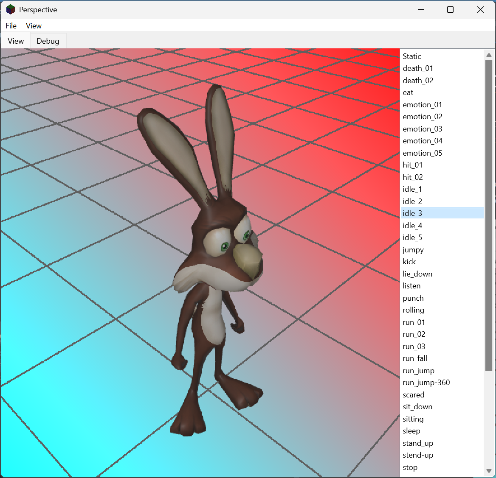

# Sprite3D

Sprite3D is a Delphi FireMonkey application for viewing 3D models from fixed and free camera angles, and for rendering them to images and icons. It is built on [Gorilla3D](https://www.gorilla3d.de/) and is meant as a tool for making sprites from 3D models: load a model, choose a view such as isometric, and grab it as a transparent PNG or a Windows icon, or export its animations as sprite strips, spritesheetes, animated GIFs or MP4 videos.

The code is split so that the 3D parts can be reused: everything in `src/lib` is independent of the application, and `src/ui` holds the forms and the application's own rules.



## Features

- **Orbit camera.** Three dials set azimuth, inclination and roll. The camera turns on a chain of single-axis pivots, so it passes over the poles without gimbal lock.
- **Fixed views.** View, Camera offers Isometric, Pixel 2:1, 1/4 View, 3/4 View, Sqrt(2), Golden Ratio, Head On, Top Down and Side View, or Variable to use the dials. The chosen view, and the dials' angles in Variable, are restored next session.
- **Lock Camera.** View, Camera, Lock Camera fixes the camera exactly where it is. While it is ticked nothing moves or turns it: the views and Orthographic are disabled, loading a model or resizing the window does not refit, and grabs, icons and animation exports use the view as it stands rather than fitting the model to their own size. Unticking it leaves the camera where it is until something else changes it. The lock can't be changed during an export, and starts off each session.
- **Pan.** View, Camera, Variable also has a Pan box, off by default. Ticked, two sliders move the view along the model's own X and Z axes, up to twice the model's radius either way, for the odd model that should sit off centre. The pan sits on top of the fit and never changes the angles or the distance; it applies in every view, and in grabs and icons, until it is switched off, and the window title says "(panned)" while it is in use. Centre puts it back to 0.
- **Fitting.** Each model is centred and the camera fitted to the volume it sweeps turning about its up axis. What that volume is depends on the Animations list. While two or more animations are ticked for export (a tick on `(None)` doesn't count), playing or paused, it is the combined volume, the rest pose and every animation used joined into one, so everything a batch exports is framed at the same scale. Otherwise, with one ticked or none, it is the volume of what is on screen alone, so that fills as much of the view as it can: the selected animation's own volume, playing or paused, or the rest pose's for `(None)` and for a model without animations. The view is refitted whenever that changes: another entry is chosen, a tick is set or cleared, or an animation is paused, stepped or played. The volume fills the view on the tighter axis, and the camera orbits a point on the turning axis, so turning the azimuth dial never pushes the model out of view. Only the distance, or the orthographic size, changes; the angles are left alone. See [Volumes](volumes.md).
- **Perspective or orthographic** projection.
- **View shape.** The view has the same shape as the grabs: as large as fits left of the Animations panel at the aspect ratio of the grab size in File, Settings, usually square, and centred on a dark grey surround. What is on screen is framed just as a grab will be, and the view takes the new shape as soon as the grab size changes. When the window opens, its width is changed so that the area left of the Animations panel has that shape too, and the view fills it with no grey at the sides; the height is kept, and the window stays on the display. A maximised window is left as it is.
- **FPS readout.** The top left of the view shows, in white on a dark backing that reads over any background, the frames per second the viewport is drawing, from Gorilla3D's `FramesPerSecond`, refreshed ten times a second. It is not part of grabs or exports.
- **Bounding box, axes and grid.** The model's bounding box, its X, Y and Z axes through its centre of rotation, and a far-reaching grid on the model's floor, the lowest point of its own geometry, that fades out with distance. Each can be switched on or off in the View menu, as can "Orthographic".
- **Model Volume and Animation Volume.** Wireframes of the volume the model sweeps turning about its up axis. Show Model Volume, on by default, draws the volume of the animation playing, or of the rest pose, in aqua and yellow, and follows each animation as it plays. Show Animation Volume, off by default, draws the combined volume, the rest pose and every animation used joined into one, in fuchsia and hot pink, but only while the view is fitted to it: while two or more animations are ticked for export. It is never drawn for a model without animations. See [Volumes](volumes.md).
- **Animations Used.** Model, Animations Used... lists the model's animations with tick boxes, and Select all / none. A column on the right gives each animation's own swept volume as a percentage of the combined volume of the rest pose and the animations ticked, updated as ticks change, so an animation that reaches much further than the rest, and would shrink every other in an export, stands out; an unticked one can show more than 100%. On OK, unticked animations leave the Animations list, so they are neither played nor exported, and leave the combined volume, and the camera is refitted; Cancel changes nothing. A new model starts with every animation used.
- **Model menu.** Animations Used..., then the settings for what is shown and saved, Animation Settings... and Background Settings... (both described below), then Directions... and Orientation; Orientation is disabled for now and will be added in a later version.
- **Directions.** Model, Directions... sets the directions a sprite set shows the model from, used by exports when **Directions** is ticked under the Animations list. A compass drawn as a clock face has a marker for each direction, the "12 o'clock" in red. A drop-down sets how many there are (1, 2, or any multiple of 4 or 6 up to 64), and a dial turns the red marker to any bearing, named when it is on one of the 32 points of the compass; **Lock to directions** makes the dial step one direction at a time. The directions are numbered clockwise or anticlockwise, or in any order with **Change Order**: click the markers in the order wanted, and the first one clicked becomes the red marker. **Export...** and **Import...** save and load the whole set as a JSON file, for artwork whose directions come in an order of its own. OK keeps it in `settings.json`. See [Directions](directions.md).
- **What is saved.** Grabs and icons are saved as the view shows them: the background, and the bounding box, axes, grid, Model Volume and Animation Volume if they are showing. Animation exports show the model alone, with none of those helpers and no background.
- **Grab.** File, Grab renders the view off screen at the grab size chosen in File, Settings (256 × 256 pixels unless changed), with the model fitted to fill the image, and saves it as the next of `grab001.png`, `grab002.png` and so on. The background is transparent unless a solid colour or gradient is chosen.
- **Save As Icon.** File, Save As Icon renders the view at each size Windows 10 and 11 use (16, 20, 24, 32, 40, 48, 64 and 256 pixels, 32-bit) and saves them as one `.ico` file. The icon writer is designed so other formats, such as macOS icons, can be added.
- **Animation export.** Every animation in the model can be saved frame by frame as a sprite strip, a spritesheet, an animated GIF or an MP4 video, one at a time or in a batch. See *Animation export* below.
- **Background.** Model, Background Settings... chooses what is drawn behind the model: None, Transparent (a two-grey checker standing for transparency, with an adjustable square size), Solid, or Gradient (top to bottom, left to right, or either diagonal). Colours can be picked or typed as hex. Grabs and icons follow the choice; animation exports never have a background.
- **Opening files from the system.** When the operating system opens the application with a model, for example a `.glb` or `.gltf` file double-clicked in Explorer or Finder, that model is loaded instead of the default one. This is handled on Windows, macOS, Linux, Android and iOS.
- **File, Save Project... / Load Project...** Save Project opens the Creator Credits dialog, for the creator, modeller and artist, each with a URL for their work, and the day the project started (today unless set). On OK the credits go into the `meta` section of every metadata file exported from then on, and Sprite3D asks where to save them as a **project file**, `<model>.sprite3d` beside the model unless you choose otherwise. Load Project opens one again. A project file is JSON holding the credits, the model's full path (`file`), the directions of Model, Directions, the Animations list (as Save Animation Settings writes it) and the export choices: grab size, animation frame rate, the Metadata and Directions ticks, and the texture atlas page size and power-of-2 choice. Loading one applies all of these; if the model it names exists and isn't the one shown it is loaded, and the Animations list is applied once it is in. `.sprite3d` files are associated with Sprite3D along with the model formats (see *File associations*), so double-clicking one opens it, and one given at start-up is loaded in place of the start-up model. On Android and iOS, which have no file dialogs, the credits are kept for the session only.
- **File, Load / Save Animation Settings...** Save writes the whole Animations list to a JSON file, `<model>_animations.json` in the model's folder unless you choose otherwise: every entry in order, with its tick and any frame count typed in, and the entry selected. Load reads such a file back and applies it: the animations it lists that the model has become the animations used, the ticks and frame counts are set as it says, and its selected entry is selected and played. Animations the model doesn't have are left out and listed; a file that names none of the model's animations changes nothing. Desktop only, with a model loaded and nothing being exported.
- **File, Settings...** A dialog for:
  - **Open model files.** Offer Sprite3D under Open With for model files and, optionally, make it their default application. Before changing a default, the one in use is recorded; clearing the box puts it back, if that application is still installed, and otherwise just removes Sprite3D's claim. Everything is per user. On Windows a default the user picked in Windows' own dialog can only be changed there, so Settings, Default apps is opened when that happens. On macOS, Open With comes from the app bundle (see below) and only the default can be changed. Android and iOS decide these things when the app is built, so the group is disabled there.
  - **Startup action.** None (no model is loaded), Load default model, or Load last model, which falls back to the default model if the last one has gone. A file the system asks Sprite3D to open always comes first.
  - **Grab size.** The size of every off-screen grab: 8 × 8, 16 × 16, 24 × 24, 32 × 32, 64 × 64, 96 × 96, 128 × 128, 160 × 160, 192 × 192, 256 × 256, 384 × 384 or 512 × 512, or Custom, where width and height are typed separately, each from 8 to 1024 pixels. Kept as `grabWidth` and `grabHeight`. Icons keep the sizes their file format needs. Below it, the grab folder in use is shown with a Reset button, which empties it so the next grab asks for a folder again.
  - **Theme.** Default (FMX's own platform style), Dark, or one of three coloured styles, Aqua Graphite, Ruby Graphite and Golden Graphite, applied at once. Title bars follow the theme where the system allows. See *Themes* below.
  - **View frame rate.** A slider from 1 frame a second up to the display's refresh rate sets how often the view is drawn, applied on OK. The refresh rate comes from `common/DisplayData.pas`: on Windows from the monitor the window is on, on macOS from CoreGraphics for each display, and on Android from the display; where the system doesn't say (iOS, Linux, and some built-in Mac panels), the slider goes up to 60. 60 unless changed; kept as `viewFps`. The rate asked for is kept, but the view is never drawn faster than the display it is on: move the window to a slower monitor and the rate drops to that monitor's refresh rate within a tenth of a second, and moving it back brings the rate asked for back. Leaving the slider at the top on a slower monitor keeps a higher rate chosen on a faster one. Lower rates use less power and leave more of the computer to other work; exports are unaffected.
  - **Minify JSON.** Off by default. Ticked, every JSON file Sprite3D writes from then on is minified, with no indents or line breaks: exported metadata, directions files, animation settings, project files, `settings.json` itself and the caches. Unticked, they are indented two spaces for people to read. Kept as `minifyJson`.
  - **Graphics processor**, Windows only: let Windows decide, low power or high power, through `common/GpuPreference.pas`. It takes effect the next time Sprite3D starts.
- **Model, Animation Settings...** A slider sets the frame rate animations are exported at, from 1 to 60 frames a second, 30 unless changed. Kept as `animationFps`. The same dialog has:
  - **Overscan.** Ticked, every grab, icon and animation export is drawn 2 to 16 times larger each way, 4 unless changed, and scaled back down to its size, which smooths edges and fine detail far better than the renderer's own anti-aliasing. As much of the factor as the GPU can draw in one go is drawn in one go, never more than 8192 pixels across, which keeps a grab's memory under about 1 GB. On many systems that is little more than the size of the view itself. The rest is made up with shifted drawings: the image is drawn several times at that size, each time with the view slid by a different fraction of a pixel, each drawing scaled down, and the results averaged, so 8x at 256 × 256 on a GPU that can only draw 512 pixels across is sixteen drawings at 2x. That takes longer, but any factor works anywhere. Each drawing is scaled down as soon as it has been made, so only one enlarged image exists at a time, and what is saved is always the size asked for. If an enlarged drawing comes back smaller than asked for, or completely transparent, that size is not tried again that session, the grab is made again with smaller drawings and more of them, and the Debug tab says so. Animation exports throw away a few warm-up grabs first; those are made without overscan. The tick is not kept: overscan starts off each session. The factor is kept as `overscan`.
  - **Resampling.** The filter overscanned images are scaled down with: Box (area average), the default and exact for a whole-number scale; Bilinear; Bicubic (Catmull-Rom); Bicubic (Mitchell); or Lanczos 3, the sharpest. Kept as `resampleFilter`.
  - **Texture Atlas.** **Page size** is the largest a texture atlas page may be each way: 1k, 2k, 4k (the default), 8k or 16k pixels. Kept as `atlasPageSize`. **Pages need not be a power of 2**, off by default, lets each page be exactly as large as its frames need; otherwise each side is the smallest power of 2 that holds them. Kept as `atlasNonPowerOf2`. See *Texture atlas* below.
- **Settings kept between sessions** in `settings.json`: the grab folder, the icon folder, the directions file folder, the Metadata and Directions export ticks, the background, the camera view, the pan, the View menu's on/off items, the animation frame rate, the view frame rate, the directions, the overscan factor and resampling filter, the texture atlas page size and power-of-2 choice, and the choices in File, Settings. The animations used are chosen afresh for each model, and overscan starts off each session.
- **Mobile layout.** On Android and iOS the menus are reached through a hamburger button.
- **Loading a model.** A model loads behind a dialog with a progress bar, a line under it saying what is happening, and an Abort button (Escape, or the dialog's close box, does the same). The file is first read in the background, which is where a cold load spends most of its time and can be aborted at once; Gorilla3D then builds the model in one step, which can't be interrupted, so Abort pressed then takes effect as soon as that step ends; then the model's animations are measured for their volumes, a slice at a time, with the percentage shown. The measurements are kept (see *Settings* below), so a model that hasn't changed skips that stage next time. The new model is built beside the one on screen, which isn't changed until the new one is ready; while the animations are measured the new model is shown in its place, as Gorilla3D only poses a model it can draw. Abort, or a file that fails to load, brings the previous model back exactly as it was, or no model at start-up. A model asked for during a load, such as a file opened from Explorer or Finder, is loaded straight after it.
- **No model.** While no model is loaded, for example with the start-up action None or after aborting the first load, the view is covered by a panel saying so and pointing to File, Open Model.
- **Quick start-up, responsive window.** The window appears before the first model loads. The FFmpeg libraries are looked for only once that load has ended, so MP4 is offered a moment later. Overscanned grabs are matted and scaled down, and strips, spritesheets, GIFs and MP4s are composed and encoded, on a worker thread, so the window keeps responding while that is done; closing the window waits for a file being written.

Model formats: glTF (`.gltf`, `.glb`), FBX, OBJ, USD (`.usdc`), Collada (`.dae`), STL and PLY, as Gorilla3D loads them.

## Requirements

- RAD Studio (Delphi) with FireMonkey.
- [Gorilla3D](https://www.gorilla3d.de/) 1.5, installed in the IDE.
- [Neon](https://github.com/paolo-rossi/delphi-neon), the JSON serialisation library, included as a Git submodule.
- Optional, for MP4 export only: the FFmpeg 8.1 shared libraries, from the DLL pack described under *Getting started*. Without them everything else works, and MP4 is simply not offered.

Target platforms: Windows (32-bit, 64-bit and ARM64EC), macOS (Intel and Apple silicon), Linux 64-bit, Android (32 and 64-bit) and iOS.

## Getting started

Clone with the submodule:

```
git clone --recurse-submodules https://github.com/peardox/Sprite3D.git
```

or, in an existing clone:

```
git submodule update --init
```

Open `Sprite3DGroup.groupproj` (or `src/Sprite3d.dproj`) in RAD Studio, choose a platform and run. Neon's source folder is already on the project's search path.

### FFmpeg libraries (optional, for MP4 export)

MP4 export uses the FFmpeg 8.1 shared libraries. They are not in the repository; download the DLL pack from

**<https://peardox.com/Sprite3d-dlls.zip>** (about 32 MB; Windows 64-bit only for now)

and extract it in the project root, the folder holding `README.md`. It creates the `dlls` folder, with one folder per platform:

```
Sprite3D/
`-- dlls/
    |-- win32/  win64/  win64arm/      Windows 32-bit, 64-bit, ARM64EC
    |-- macx64/  macarm/               macOS Intel, Apple silicon
    |-- linux64/                       Linux
    |-- android32/  android64/         Android
    `-- iosarm64/  iossimarm64/        iOS device, simulator
```

Only `win64` is in the pack so far. The `.gitignore` keeps `.dll`, `.so` and `.dylib` files out of Git, so the extracted libraries are never committed.

Each folder holds five libraries: avutil, swresample, swscale, avcodec and avformat. Their names follow each platform's own rules:

| Platform | Names |
|---|---|
| Windows | `avutil-60.dll`, `swresample-6.dll`, `swscale-9.dll`, `avcodec-62.dll`, `avformat-62.dll` |
| macOS, iOS | `libavutil.60.dylib`, `libswresample.6.dylib`, `libswscale.9.dylib`, `libavcodec.62.dylib`, `libavformat.62.dylib` |
| Linux | `libavutil.so.60`, `libswresample.so.6`, `libswscale.so.9`, `libavcodec.so.62`, `libavformat.so.62` |
| Android | `libavutil.so`, `libswresample.so`, `libswscale.so`, `libavcodec.so`, `libavformat.so` (Android only unpacks `lib*.so` files from an APK) |

They must be FFmpeg 8.1's (avutil 60, avcodec 62, avformat 62) and include the MPEG-4 encoder, which every standard build does. Sprite3D loads them only to offer MP4: if they are missing or the wrong version, the program runs exactly as before and MP4 is not offered. The Debug tab says at start-up which happened, and from where they were loaded.

#### Deployment

The project's deployment entries copy each platform's libraries from `dlls/<platform>` to that platform's usual place for an application's own libraries, which is also the first place Sprite3D looks:

| Platform | Deployed to |
|---|---|
| Windows (32-bit, 64-bit, ARM64EC) | beside `Sprite3d.exe` |
| macOS | `Sprite3d.app/Contents/Frameworks` |
| Linux | a `lib` folder beside the executable |
| Android | the APK's `lib/armeabi-v7a` or `lib/arm64-v8a`, unpacked by the system |
| iOS | `Sprite3d.app/Frameworks` |

After that it looks beside the executable, in `dlls/<platform>` beside it, and in `dlls/<platform>` in each of the six folders above it, so a build run from `src/Win64/Debug` finds the repository's `dlls/win64` without deploying; and last wherever the system looks for shared libraries.

An ARM64EC build (Windows on ARM) can load x64 and ARM64EC libraries but not plain ARM64 ones, so `dlls/win64arm` normally holds a copy of the x64 libraries in `dlls/win64`. Run from the source tree, it also looks in `dlls/win64` after `dlls/win64arm`, so the copy is only needed for deploying.

Until a platform's folder has its libraries, deploying for that platform reports them as missing; untick them in Project, Deployment, or add the libraries. On macOS and iOS the libraries are signed with the app when it is signed, and the hardened runtime must allow libraries from other developers (`com.apple.security.cs.disable-library-validation`) unless they are signed with the app's own team ID.

The libraries are needed only at run time, never to build: Sprite3D does not link against them on any platform, so every platform builds without them.

### OpenH264 (optional, for H.264 MP4 files)

On its own, FFmpeg's MP4 export writes MPEG-4 Part 2 video, which desktop players handle but web browsers do not. With Cisco's [OpenH264](https://github.com/cisco/openh264) library as well, MP4 files are H.264 instead, which plays everywhere.

OpenH264 is never shipped with Sprite3D: Cisco pays the H.264 patent royalties only for copies of its library downloaded from Cisco. Instead, Sprite3D downloads it itself, from the address given for the platform in **`openh264.json`**, in the project root:

```json
{
  "win32": "",
  "win64": "https://.../openh264-2.6.0-win64.dll.bz2",
  "win64arm": "https://.../openh264-2.6.0-win64.dll.bz2",
  "macx64": "",
  "macarm": "",
  "linux64": "",
  "android32": "",
  "android64": ""
}
```

- **An empty address means no H.264 on that platform**: MP4 files are MPEG-4 Part 2 there. Every address starts empty.
- **Downloaded once, then kept.** At start-up Sprite3D checks whether the copy it has came from the address now given. If it did, it is used straight away, with no network. If not, or there is no copy yet, it is downloaded in the background while Sprite3D starts, and used as soon as it arrives.
- **Updates.** Change an address, for example from 2.6.0 to 2.6.1, and the next start downloads the new version, which replaces the old one.
- **Failures.** A 404, any other HTTP error, no network, a timeout, or a download that is not a library for the platform means OpenH264 is not available this time; MP4 files are MPEG-4 Part 2 and the download is tried again at the next start. The Debug tab says what happened.
- **Formats.** Cisco's `.bz2` files can be used as they are; `.gz` and plain libraries work too. Use Cisco's 2.0 or later; `https` addresses are best, as macOS, iOS and Android refuse plain `http` by default.
- **Where it goes.** An `openh264` folder in the settings folder (see *Settings*), with an `installed.json` recording the address each copy came from. Delete the folder to force a fresh download.
- **`win64arm`** is Windows on ARM (ARM64EC). It can load x64 libraries but not Cisco's plain ARM64 build, so give it the same x64 (`win64`) address as `win64`.
- **iOS** does not allow downloaded code to be loaded, so it has no entry and never has H.264.

`openh264.json` is deployed beside the executable on Windows and Linux, in `Contents/Resources` on macOS and in the app's files on Android, so a shipped Sprite3D can be pointed at a new version by updating that one file. Run from the source tree, Sprite3D reads the repository's copy.

Only the copy downloaded from the address in `openh264.json` is ever loaded: an OpenH264 placed in `dlls` or elsewhere by hand is not used.

### First run

On start-up the application loads `models/uvcube.glb`, a cube with its faces labelled, from the repository's `models` folder. On Windows it looks for `models` in the current folder first, then three levels up, which is the repository root when run from `src/<platform>/<config>`. On macOS the folder is expected in the user's Library folder and on Linux in the home folder.

## Project layout

```
Sprite3D/
|-- Sprite3DGroup.groupproj
|-- README.md
|-- viewport.md, offscreen.md, volumes.md, directions.md, metadata.md  design notes
|-- delphi-neon/              Neon JSON library (submodule)
|-- docs/                     generated API help (PasDoc)
|-- models/                   sample model: uvcube.glb
|-- dlls/                     FFmpeg libraries, from the DLL pack; not in Git
|-- openh264.json             where to download OpenH264 for each platform
`-- src/
    |-- Sprite3d.dpr, .dproj, .res, Sprite3d_Icon.ico
    |-- ffmpeg/               DelphiFFmpeg.com FFmpeg 8.1 headers, unchanged, for reference
    |-- styles/               the themes' FMX styles, linked into the program
    |   |-- Sprite3DThemes.rc        the RCDATA resources
    |   `-- buildstyles.cmd          pre-build: copies the .style files, builds the .res
    |-- lib/                  reusable units, no application code
    |   |-- Sprite3DCamera.pas       orbit camera, fitting, view extents
    |   |-- Sprite3DAxes.pas         a model's X, Y and Z axes
    |   |-- Sprite3DGrid.pas         floor grid drawn by a GLSL shader
    |   |-- Sprite3DSweep.pas        swept volumes: measuring, wireframes, camera fit
    |   |-- Sprite3DOffscreen.pas    off-screen rendering with transparency and overscan
    |   |-- Sprite3DResample.pas     resampling filters for scaling overscanned grabs down
    |   |-- Sprite3DBackground.pas   none, checker, colour or gradient background
    |   |-- Sprite3DIconWriter.pas   icon file writers (Windows .ico)
    |   |-- Sprite3DOpenFiles.pas    files the system asks the app to open
    |   |-- Sprite3DFileAssoc.pas    Open With and default-application registration
    |   |-- Sprite3DStyles.pas       switching FMX styles at run time
    |   |-- Sprite3DTitleBar.pas     title bars coloured to match the style
    |   |-- Sprite3DStorage.pas      per-user app folder and JSON settings
    |   |-- Sprite3DAnimCapture.pas  grabs every frame of an animation, or of a turn
    |   |-- Sprite3DSpriteSheet.pas  strips, spritesheets, PNG and animated GIF writers
    |   |-- Sprite3DVideo.pas        MP4 writer, loading FFmpeg only when present
    |   |-- Sprite3DOpenH264.pas     H.264 encoder, loading the downloaded OpenH264
    |   |-- Sprite3DLibraryUpdate.pas downloads and updates a library from a JSON address
    |   |-- Sprite3DBzip2.pas        bzip2 decompression, for Cisco's .bz2 downloads
    |   `-- Sprite3DNativeLibs.pas   each platform's folders for an app's own libraries
    |-- common/               small cross-project helpers
    |   |-- OSPaths.pas              where the program and its assets are; OS-friendly paths
    |   |-- GpuPreference.pas        Windows' per-program GPU preference
    |   `-- DisplayData.pas          the displays, their modes and refresh rates, per platform
    `-- ui/                   the application
        |-- Sprite3dMain.pas, .fmx           main form
        |-- Sprite3DBackgroundForm.pas, .fmx Background Settings dialog
        |-- Sprite3DOrbitalForm.pas, .fmx    Variable camera dialog, with the pan
        |-- Sprite3DSettingsForm.pas, .fmx   Settings dialog
        |-- Sprite3DAnimationForm.pas, .fmx  Animation dialog: the export frame rate
        |-- Sprite3DAnimationsUsedForm.pas, .fmx  Animations Used dialog
        |-- Sprite3DLoadForm.pas, .fmx       model loading dialog
        |-- Sprite3DDirectionsForm.pas, .fmx  Directions dialog: the compass
        |-- Sprite3DExportForm.pas, .fmx  batch export progress dialog
        `-- Sprite3DHelpers.pas              application rules and settings
```

## Animation export

The Animations list on the right of the View tab shows the animations used, by name, after a first entry, `(None)`, which shows the model as loaded. Clicking an entry plays it, and so does moving to it with the Up and Down arrow keys, Home, End or the page keys. Under the list, five buttons, with icons and their names as hints, act on the selected animation: **first frame**, **previous frame**, **play / pause**, **next frame** and **last frame**. The frames are the ones an export makes at the Model, Animation Settings frame rate, shown exactly as the export will show them, so you can check any frame before saving. The four frame buttons pause the animation on their frame; stepping wraps round from the last frame to the first and back. After the buttons, a readout such as `3 / 24` always shows the frame showing, held or playing, and the frames an export makes; the `/` stays in the same place whatever the numbers, and it reads `- / -` when there is nothing to count, as for `(None)`. Play and pause share one button, whose icon and hint change to say which it does. Choosing an entry shows it paused on its first frame; once **play** has been pressed, choosing an entry plays it from the start instead, until **pause** or a frame button is pressed again. Starting an export lets a held animation play on. The Frames column beside each entry shows how many frames exporting it makes at the Model, Animation Settings frame rate, and is updated when the rate changes; for `(None)` it is 1, as `(None)` exports a single still frame of the bind pose. **Double-click a frame count to change it**: type the number of frames to export that animation in and press Enter, or leave the box; Escape leaves it as it was, and an empty box or 0 goes back to the count the frame rate gives. A count typed in replaces the automatic one for every export of that animation, and for the frame buttons and readout, whatever the frame rate, and is shown in italics. Counts typed in are kept until another model is loaded, and are saved with File, Save Animation Settings. Model, Animations Used... chooses which animations are listed.

### One animation

Right-click an entry to select and play it and open a menu:

| Item | Saves | File name |
|---|---|---|
| Save as sprite strip | every frame side by side in one row | `<animation>_strip<frames>.png` |
| Save as Spritesheet | every frame in a square grid, left to right then top to bottom; any cells after the last frame are transparent | `<animation>.png` |
| Save as AniGif | an animated GIF that loops for ever | `<animation>.gif` |
| Save as MP4 video | a video-only MP4 file, H.264 when OpenH264 is present and MPEG-4 Part 2 otherwise; offered only when the FFmpeg libraries load | `<animation>.mp4` |

Files go to the grab folder, which is asked for the first time, as for File, Grab. A file with the same name is replaced. Characters that are not allowed in file names become underscores.

`(None)` has no animation, so it saves a single still frame of the model in its bind pose instead, named after the model, such as `uvcube.png`.

On Android and iOS, which have no right-click, the same items are in the Animation group of the menu drawer and act on the selected entry.

### Batch export

Each entry has a tick box. Below the list:

- **All** ticks every animation, or clears every entry. It leaves `(None)` as it is, so the turn is only exported when you tick it yourself. It doesn't change which entry is selected, or the animation playing.
- The drop-down chooses **Sprite strip**, **Spritesheet**, **Texture Atlas**, **AniGif** or, when FFmpeg loaded, **MP4 video**. Choosing Texture Atlas asks straight away for the folder its pages go in, opening at the grab folder; cancel, and the drop-down goes back to what it was. See *Texture atlas* below.
- **Metadata**, above Export, saves a JSON file beside each strip, spritesheet or atlas page, with the same name and the extension `.json`; see *Metadata* below. It is offered only for strips and spritesheets, applies to the right-click menu's strips and spritesheets too, and is remembered between sessions. A texture atlas always has its metadata, as without it the animations on a page can't be told apart: while Texture Atlas is chosen the box shows ticked and greyed out, and choosing another format shows your own choice again.
- **Directions**, beside it, exports every animation in each direction set in Model, Directions, in the order set there, one direction after another for each animation before the next animation. For each direction the camera is turned round the model by the direction's bearing, as turning the azimuth dial on by that much would, so bearing 0 is the view as it is; the framing is the same in every direction. A strip then has one row per direction, a spritesheet holds every direction's frames in its grid, a texture atlas packs them in turn, and an AniGif or MP4 is one file per direction, `<animation>_dir01.gif` and so on. The metadata's `directions` lists the directions' bearings in that order, and each frame's `direction` says which it is. Abort stops at the end of the animation under way, once all its directions are saved. The right-click menu's saves use the directions too while it is ticked. It is remembered between sessions.
- **2-pass**, beside Directions, is for a two-pass export still to come: for now it has no effect on exports. It is not remembered: it starts clear each session, and project files leave it out.
- **Export** asks for a folder (except for a texture atlas, which uses the folder chosen with it), opening at the grab folder so a new sub-folder can be made there for the batch, then saves every ticked entry that way, one after another. The grab folder itself does not change. The ticks are left as they were, so the same batch can be exported again, and once it ends the entry selected before it is selected and playing again. Failures do not stop the others.
- **Progress.** While the batch runs, a dialog shows a progress bar for the whole batch, which animation it is on and which frame is being captured or that it is being saved, and a list of the files saved so far. **Abort** in it stops the batch once the animation being captured has been saved, as does Escape or the dialog's close box. While it runs, an estimate of the time remaining is shown under the bar, as hours, minutes and seconds (H:MM:SS, the hours going past 24 rather than into days), from the time taken so far; it appears after the first couple of seconds, and while an atlas's pages are being made it says that part is not estimated. At the end it shows what was exported, how long the export took (for a texture atlas, split into the capturing and the making and saving of the pages), and any failures, in place of a separate message; Abort is then disabled and **Close** enabled.
- **No redrawing meanwhile.** Every frame of an export is drawn off screen, so the view's own timed redraws are stopped while a batch runs, and the view is drawn only as the grabs need. On macOS and iOS, where grabs are screenshots of the view, it carries on drawing.
- **Abort**, under the list and in the progress dialog, enabled only while a batch runs, lets the animation being captured finish and save, then drops the rest. Entries not yet exported stay ticked.
- **Quitting mid-export.** Closing the window while anything is being captured, exported or written asks *Still exporting. Do you really want to quit?* No carries on with the export. Yes stops it and quits: the capture under way and anything not yet saved, such as a texture atlas's pages, are dropped, while files already being written are finished first, so none is left half written.

### Texture atlas

A texture atlas is the animations of a batch packed together onto shared pages, each a spritesheet of several animations. Export captures every ticked entry first, then lays out the pages:

- **Order.** The animations go on in the order of the Animations list, their frames left to right and then down, each one's straight after the last one's. When a page is full the next frame starts the next page, even partway through an animation, so every page but the last is full and an animation of any length fits.
- **Page size.** A page holds as many frames, of the grab size, as fit in the page size from Model, Animation Settings each way: at 4k with 256 × 256 frames that is 16 × 16 = 256 frames. Each page is then made as small as its frames allow: powers of 2 each way, the least area first and then the squarest, or with *Pages need not be a power of 2* ticked, exactly the grid of frames it needs. Cells after the last frame are left transparent, and the metadata's `unused` counts them.
- **Names.** The pages are named after the model, `<model>_atlas_01.png`, `<model>_atlas_02.png` and so on, each with its `.json`, which an atlas always has, listing the animations with frames on that page in `animations`, each one's whole frame count in `animation_frames`, and, for every frame, which animation, direction and frame it is. Before the new pages are written, every existing `<model>_atlas_<number>.png` in the folder, and the `.json` beside each, is deleted, so no page is left over from an earlier, larger atlas; nothing else is touched, and nothing is deleted if there is no new page to write.
- **Abort** stops capturing after the current animation; the pages are still made from what was captured.
- **Memory.** Every frame of the batch is kept until the pages are made, and a 16k page alone takes 1 GB to make, so a large atlas needs plenty of memory.

Every animation of a batch is framed alike, so they share one origin.

### Metadata

With **Metadata** ticked, a strip or spritesheet, and always an atlas page, is followed by a JSON file of the same name, such as `walk_strip24.json` beside `walk_strip24.png`. It starts with a `meta` section: the page and the number of pages, the creator credits from File, Save Project, the day the project started, when the export was made, and the model file. It then gives the image's size and layout; the `origin`, the pixel the model's centre of rotation falls on in every frame, as integers; the animations it holds in `animations`, with their frame counts in `animation_frames`; the number of empty cells after the last frame in `unused`; and, in `frames`, one entry per frame saying which animation, direction and frame it is, with its *empty sections*, the fully transparent columns and rows at its edges, with `sprite_empty`, the smallest of each over all the frames, so every frame can be cropped by the same amount without losing anything. See [Metadata](metadata.md) for the format and how each value is worked out.

### How the frames are made

- **Size and framing.** Every frame is grabbed off screen at the grab size from File, Settings, with no background, whatever Model, Background Settings shows behind the model on screen. The camera is framed once for the whole animation, so the model is the same size and in the same place in every frame and the frames line up. An animation saved on its own, from the right-click menu, is framed around its own swept volume, so it fills the image as far as its own poses allow. A batch, and the `(None)` still, are framed around the combined swept volume of the rest pose and every animation used, so every animation of a batch is at the same scale. The view on screen is put back afterwards. See [Volumes](volumes.md).
- **Frame rate.** Model, Animation Settings... sets it (30 frames a second unless changed). An animation lasting *D* seconds is cut into *N* = *D* × rate frames, rounded, and frame *i* shows the pose at *i* × *D* / *N* seconds. The frame after the last would be at *D*, which in a looping animation is the first pose again, so the frames loop with no jump and no repeated frame. To keep a whole number of frames in the cycle, the rate actually used is *N* / *D*: 8 frames a second on a 1.3-second walk gives 10 frames of 0.13 seconds. GIFs and MP4s play the frames at that rate, so they last exactly one cycle.
- **Warm-up.** An animation that has just been started can take a few drawn frames to show its first pose, and until then the model can still be in the pose it had before, or sit at another height. So before each animation is captured, its first frame is grabbed three times and those grabs are thrown away; only then is it grabbed for keeping.
- **Poses, not blended images.** Gorilla3D bakes each animation into poses about 60 times a second on desktop, interpolating between the file's keyframes. Each frame uses the baked pose nearest its time, within 1/120 of a second, and images are never blended, which would leave ghosts in a sprite. A rate above the baked rate repeats some poses.
- **Transparency.** Strips, spritesheets and GIFs are transparent around the model. GIF allows only fully transparent or fully opaque pixels, so soft edges become one or the other, and each frame has its own palette of up to 255 colours. MP4 has no transparency: frames are laid over black.
- **Memory.** A capture is refused, with a message, if its frames would need more than 1 GB; choose a smaller grab size for very long animations.

### MP4 video

MP4 files are video only, with a key frame every 12 frames and no B-frames. Which codec they use depends on the libraries found; the Debug tab names the codec of each file saved.

| Libraries found | Codec | Plays in |
|---|---|---|
| FFmpeg and OpenH264 | H.264 Constrained Baseline, from OpenH264, at a constant quality of about a quarter of a bit per pixel per frame | everything, web browsers included |
| FFmpeg only | MPEG-4 Part 2, FFmpeg's own `mpeg4` encoder, at a fixed high quality | desktop players such as VLC, QuickTime and the Windows players, but not web browsers |
| neither | MP4 is not offered | |

Odd widths and heights get one black row or column added, as both encoders need even sizes. Grabs smaller than 16 pixels across or down are always MPEG-4 Part 2, as OpenH264 cannot take them. See *FFmpeg libraries* and *OpenH264* above.

## Settings

Settings are kept in `settings.json`, written by Neon, in the folder each platform expects:

| Platform | Folder |
|---|---|
| Windows | `%APPDATA%\Sprite3D` |
| macOS | `~/Library/Application Support/Sprite3D` |
| Linux | `$XDG_CONFIG_HOME/Sprite3D`, or `~/.config/Sprite3D` |
| Android | the application's documents folder |
| iOS | `Library/Application Support/Sprite3D` |

The file is plain JSON and can be edited by hand. Colours are written as `#AARRGGBB`.

The same folder has a `bounds` folder: the measured bounds of each model's animations, one small JSON file per model, named from a hash of the model's full path, size and time of last change. A model that is edited, replaced or moved is simply measured again, and its old file is no longer used. The folder can be deleted at any time; nothing is lost but the time it takes to measure again.

## Themes

The themes other than Default are FMX styles that come with RAD Studio, in its `Redist\styles\Fmx` folder:

| Theme | Style file | Look |
|---|---|---|
| Dark | `Dark.style` | dark grey |
| Aqua Graphite | `AquaGraphite.style` | dark grey with blue |
| Ruby Graphite | `RubyGraphite.style` | dark grey with red |
| Golden Graphite | `GoldenGraphite.style` | dark grey with gold |

The four styles are linked into the program as RCDATA resources, so every build, Debug or Release, on every platform, carries them inside it and there is nothing to deploy. The project's pre-build event runs `src/styles/buildstyles.cmd`, which:

1. copies any style missing from `src/styles` out of `$(BDS)\Redist\styles\Fmx`; files already there are left alone, so a style can be swapped by hand;
2. compiles `src/styles/Sprite3DThemes.rc` with RAD Studio's `brcc32`, from that folder, into `Sprite3DThemes.res`, which `Sprite3d.dpr` links in.

The `.rc` is compiled there rather than by the IDE because the IDE resolves its file names from the project folder and may compile it before the pre-build event has run. If a style or `brcc32` can't be found, or the compile fails, the build stops with an error saying which.

At run time each theme's resource, such as `Sprite3DAquaGraphiteStyle`, is used first. Should one be missing, Sprite3D falls back to looking for the `.style` file, matched regardless of case:

1. in a `styles` folder beside the program (or, when run from the IDE, in the repository root), or beside the program itself;
2. in a `styles` folder in the settings folder above;
3. on Windows, when run from the IDE, in RAD Studio's own `Redist\styles\Fmx` folder.

If a style cannot be found at all, the theme and title bars stay as they were and the places tried are reported.

Title bars follow the theme, using the style's own form background colour and the theme's accent colour for the window border:

| Platform | Title bar |
|---|---|
| Windows 11 | the caption takes the style's background colour, with black or white text, whichever reads better, and the accent as the border |
| Windows 10 | dark for the dark themes; Windows 10 cannot colour a title bar |
| macOS 10.14 on | dark appearance for the dark themes, for the whole application |
| Linux | unchanged: the window manager draws it |
| Android, iOS | no title bar |

## File associations

| Platform | Open With | Always open with |
|---|---|---|
| Windows | `HKCU\Software\Classes`: a `Sprite3D.Model` ProgID, `Applications\Sprite3d.exe` and each extension's `OpenWithProgids`; also listed in Settings, Default apps | the extension's per-user default; a default chosen in Windows' own dialog can only be changed there |
| Linux | `~/.local/share/applications/sprite3d.desktop` and a shared-mime-info package in `~/.local/share/mime/packages` | `[Default Applications]` in `~/.config/mimeapps.list` |
| macOS | `CFBundleDocumentTypes` in `src/info.plist.TemplateOSX.xml` | Launch Services |
| Android, iOS | not available | not available |

Sprite3D's own project files, `.sprite3d`, are associated each time Sprite3D starts, whatever is chosen for model files: on Windows they get a ProgID of their own, `Sprite3D.Project`, made the extension's default in `HKCU\Software\Classes\.sprite3d`; on Linux the MIME type `application/x-sprite3d` goes into the desktop entry and is made its default in `mimeapps.list`; on macOS they are a second document type in the bundle, with Sprite3D as their owner. If you once picked another program for them with *Always* in Windows' own *How do you want to open this file?* dialog, that choice still wins; pick Sprite3D there once, or in Settings, Default apps.

The previous defaults are kept in `settings.json` as `associationBackup` until they have been put back.

## Documentation

Every public item in the source carries two kinds of documentation comment: `///` XML comments for Help Insight in the IDE, and `//**` comments for [PasDoc](https://pasdoc.github.io/). The HTML help is in `docs/lib` and `docs/ui`, one set for each source folder, built from within that folder with, for example:

```
cd src/lib
pasdoc --staronly --auto-abstract --format html --output ../../docs/lib *.pas
```

## Licences

- `src/ffmpeg` holds the FFmpeg Delphi/Pascal headers from [DelphiFFmpeg.com](http://www.delphiffmpeg.com/headers/), unchanged. They are not compiled into Sprite3D: they bind FFmpeg statically, and define some error codes only for Windows and macOS, so `Sprite3DVideo.pas` instead declares the few records and constants it needs, copied from them, and loads the libraries itself. The headers and those declarations are under DelphiFFmpeg.com's BSD-style licence, in `src/ffmpeg/LICENSE.txt`: the notice must stay with the source, and binaries must reproduce it in their documentation.
- The FFmpeg libraries in the DLL pack are under FFmpeg's own licence, the LGPL for the builds used. Shipping them with Sprite3D brings the LGPL's conditions for those libraries.
- `src/lib/Sprite3DOpenH264.pas` translates declarations from OpenH264's API headers, Copyright (c) 2013, Cisco Systems, under the BSD 2-clause licence: the notice stays with the source, and binaries must reproduce it in their documentation. The OpenH264 library itself is not distributed with Sprite3D; Cisco's binary licence and its H.264 patent cover apply to copies downloaded from Cisco.

## Paths

Every file the application opens or writes, models, settings, the bounds cache, grabs, icons, exports and the video libraries, goes through `OSFriendlyPath` in `common/OSPaths.pas` first, which gives it the platform's own delimiters: only `\` on Windows and only `/` elsewhere, with doubled delimiters inside the path made single. Some Windows targets, such as Win64 on ARM (ARM64EC), don't accept `/` in every path, and a model path kept in `settings.json` on one system may be read on another.

## Known issues

- On macOS and iOS, where Gorilla3D renders through Metal, grabs and icons are screenshots of the view as shown, cropped to the grab's shape and scaled: the model is not refitted for them, and they are opaque, with the viewport's own background.
- In orthographic projection the viewport background is not drawn, as Gorilla3D draws it black over the whole scene there. Grabs are not affected.
- Background colours in the viewport show about 1.25 times brighter than chosen. Grabs and icons use the exact colours.
- Android would need intent filters, and iOS document types, added to their manifest and Info.plist for Open With; neither is set up yet.
- The camera view and View menu ticks are saved when the main form is destroyed, which Android and iOS do not always do before ending an application.
- Animations are all treated as loops: for one that does not loop, the last pose is left out of the export.
- On macOS and iOS, animation frames are screenshots, as grabs are there, so they share the limits above.
- MP4 export has been tested on Windows 64-bit; the macOS and Linux libraries are not in the DLL pack yet.
- H.264 export through OpenH264 has been tested on Windows 64-bit with OpenH264 2.6.0. Versions 2.0 to 2.5 lay out the encoder's output differently; Sprite3D allows for that, but has not been tested with them.
- The OpenH264 download and the deployment entries for platforms other than Windows 64-bit are new and untested.
- The first time a model's volumes are needed, which is when it loads, every pose of every animation is measured, and the application does not respond until that is done. For a model with many long animations this can take a moment.
- The swept volumes are built from bounding boxes, so a model that fills little of its box is framed with room to spare.
- Overscan is done on the CPU, after each grab is read back. A high factor with a wide filter is slow, Lanczos 3 at 16x most of all, and an export makes one such grab per frame. Box is the quickest. Where the GPU cannot draw the whole factor at once, each grab is several drawings, which multiplies the time again: 8x at 256 × 256 with drawings of 512 pixels is sixteen drawings a frame.
- Shifted drawings slide the camera rather than the projection. In orthographic views that is exact; in perspective, parts of the model much nearer or further than its centre are sampled a fraction of a pixel off, which only shows as slightly softer anti-aliasing there.
- Overscan does not apply on macOS and iOS, where grabs are screenshots of the view.

## Further reading

- [Viewport](viewport.md): how the viewport background is drawn, and why it is built the way it is.
- [OffScreen](offscreen.md): how the offscreen rendering works, and why it is built the way it is.
- [Volumes](volumes.md): the volume a model sweeps turning about its up axis, how it is measured for each animation, and how the camera is fitted to it.
- [Metadata](metadata.md): the JSON saved beside a strip or spritesheet, and how its empty sections and origin are measured.
- [Directions](directions.md): the Model, Directions dialog, how the order of the directions works, Change Order, and the directions file Export and Import use.
