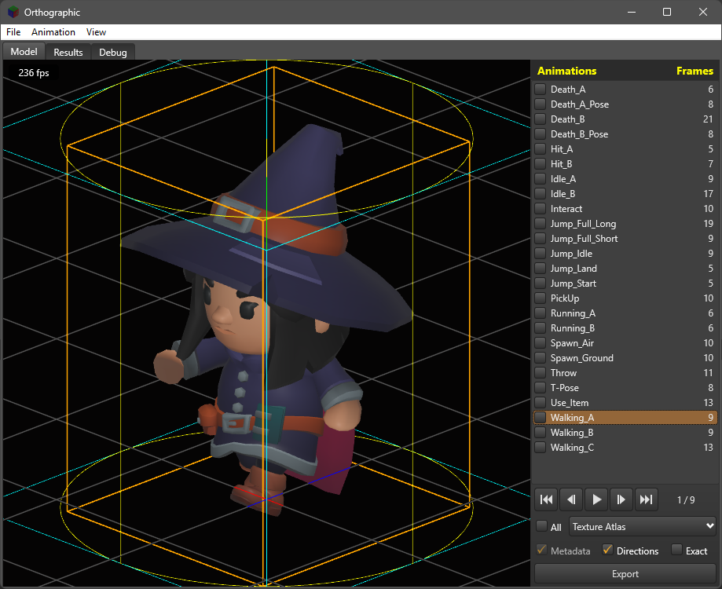
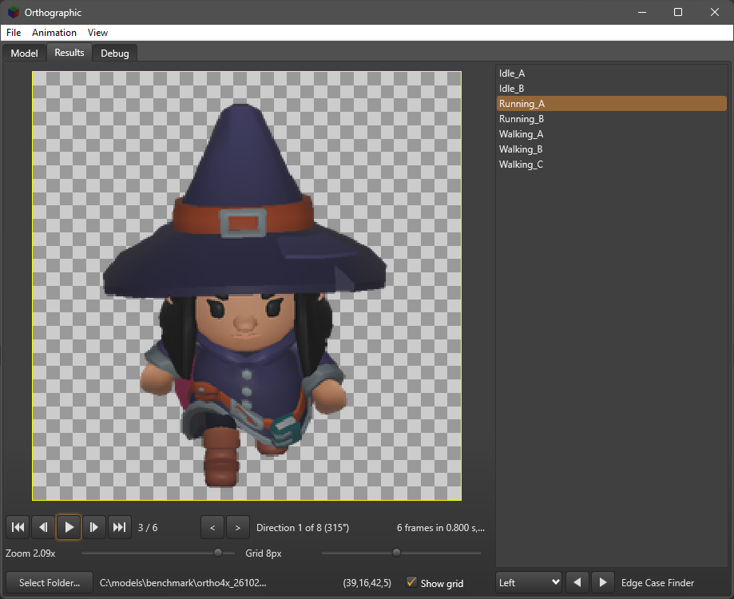

# Sprite3D

Sprite3D is a Delphi FireMonkey application for viewing 3D models from fixed and free camera angles, and for rendering them to images and icons. It is built on [Gorilla3D](https://www.gorilla3d.de/) and is meant as a tool for making sprites from 3D models: load a model, choose a view such as isometric, and grab it as a transparent PNG or a Windows icon, or export its animations as sprite strips, spritesheets, animated GIFs or MP4 videos.

The code is split so that the 3D parts can be reused: everything in `src/lib` is independent of the application, and `src/ui` holds the forms and the application's own rules.



## Requirements

- RAD Studio (Delphi) with FireMonkey.
- [Gorilla3D](https://www.gorilla3d.de/) 1.5.4 or later, installed in the IDE. USD files need 1.5.4: 1.5.3's USD loader had faults, so Sprite3D did not load USD with it.
- Spritely, the camera components in `Spritely/` (see [Spritely/README.md](Spritely/README.md)): its runtime package built for each platform you compile for, and its design package installed in the IDE. Sprite3D uses its orbital camera, `TSpritelyOrbitalCamera`.
- [Neon](https://github.com/paolo-rossi/delphi-neon), the JSON serialisation library, included as a Git submodule.
- GLTFLib, the glTF library of [GLTFMerge](https://github.com/G3DGames/GLTFMerge), from the `ImportTests/GLTFMerge` submodule, for File, Debug, glTF.
- Optional, for MP4 export only: the FFmpeg 8.1 shared libraries, from the DLL pack described under *FFmpeg libraries* below. Without them everything else works, and MP4 is simply not offered.

Target platforms: Windows (32-bit, 64-bit and ARM64EC), macOS (Intel and Apple silicon), Linux 64-bit, Android (32 and 64-bit) and iOS.

## Getting started

Clone with the submodules:

```
git clone --recurse-submodules https://github.com/peardox/Sprite3D.git
```

or, in an existing clone:

```
git submodule update --init
```

Open `Sprite3DGroup.groupproj` in RAD Studio. It holds the Spritely packages, Sprite3D and Spritely's test program ProjectionTest, built in that order:

1. Build **Spritely** for every platform you compile Sprite3D for, and always for **Win32**, which the IDE's design package needs.
2. Build **dclSpritely** (Win32) and **Install** it (right-click in the Projects window). The Spritely page appears on the palette, and the form designer can open the main form, which holds a `TSpritelyOrbitalCamera`. If Spritely was installed before from another folder, remove that dclSpritely from Component, Install Packages first.
3. Choose a platform for **Sprite3d** and run. Neon's source folder is already on the project's search path; Spritely needs no path, as its package puts its compiled units in Delphi's Dcp folder.

A build failing with *F2613 Unit 'Spritely.OrbitalCamera' not found* has not got Spritely built for the platform it is compiling for. After a change in `Spritely/lib`, rebuild Spritely for each platform used, and reinstall dclSpritely; see [Spritely/README.md](Spritely/README.md).



## Features

- **Static and Animated tabs.** Models are kept on two tabs, which share the view and the panel beside it. The **Static** tab, first, is for models without animations: its panel, headed *Models*, lists every static model opened this session, by file name without the extension, and shows the one selected; there are no frame counts or play buttons, and AniGif and MP4 video are not offered. The **Animated** tab is for one model with animations: its panel, headed *Animations*, lists them, with the frame counts and the play and step buttons. Opening a model sends it to the tab that fits it and shows that tab, once loading has finished and the loading dialog has gone, so the tab never changes under it (for File, Open Directory, once the whole folder is done, showing the tab of the last model opened): a model with animations replaces the Animated tab's, and one without is added to the Models list and selected. A model for the tab already showing is shown as soon as it is loaded. Opening the same static file again on its own loads it afresh in its place. Every model opened stays loaded, hidden while another is shown, so moving between models and tabs is instant. **Clear**, beside Export on both tabs, empties the tab's list and unloads its models: the Animated tab's model, or every static model.
- **Name clashes.** A static model whose name is already in the Models list, from a different file (or any file, while a folder is opened), is not listed straight away. A dialog asks what to do: **Replace** unloads the model listed and puts the new one in its place, under the same name; **Ignore** leaves the list as it is and drops the new one; **Rename** lists the new one too, as `name (2)`, `name (3)` and so on, the first name that is free, which its button shows. Closing the dialog counts as Ignore. Exports of a renamed model use its new name, so their files don't overwrite the other's.
- **File, Open Directory...** asks for a folder, typed or chosen with **Browse...**, and a file spec, typed or picked: one pattern such as `*.glb`, or several separated by `;`, such as `*.glb;*.gltf`, with every model format at the foot of the list. The folder and all its sub-folders are searched in the background, matching names in any case on every platform, and every model found is then opened in turn behind one loading dialog, which stays open for the whole folder and says which file of how many it is loading. Each goes to the tab that fits it. Only one model with animations can be open, so one is opened only if there is no animated model open already, and every later one is skipped. Static models are all added, and name clashes are asked about as above, with **Do the same for every other clash in this folder** to answer the rest alike. **Abort** in a loading dialog stops the whole folder. At the end the dialog simply closes, and if any static model was opened the first entry of the Models list is selected; how many were opened on each tab, skipped, ignored and failed, with why each failed, is written to the Debug tab. The folder and spec are remembered between sessions. On Android and iOS, which have no folder dialog, the folder is typed.
- **File, Debug, Tools, Scan Sprites...** (only while debugging is on) measures a sprite made elsewhere that one of Sprite3D's is to replace. Each animation, pose or action of it is a folder of frames, one PNG file per frame. The system's folder dialog asks for the folders: on Windows and macOS several at once, with Ctrl- (Command-) or Shift-click; on Linux, whose dialog chooses one, choose the folder that holds them. A folder with no PNG files of its own stands for each of its sub-folders that has some, so choosing a character's folder scans every one of its animations. The folders are read in the background. In each, every PNG is read (any kind of PNG: greyscale, truecolour, indexed, with or without alpha, 1 to 16 bits, interlaced or not), and each frame is measured exactly as the export metadata measures it (see [Metadata](notes/metadata.md)): its empty border, the fully transparent columns and rows at each edge, alpha 0 only, and its active pixels, every pixel not fully transparent. The borders are combined over the folder as `sprite_empty` is, the least of each side, so the frames cropped by them are all the same size and still hold every frame. **Every frame of every folder must be exactly the same size**: if any two differ, the scan has failed, as none of its figures would mean anything, and instead of the grid a message names two frames that differ. Otherwise the folders are combined the same way, as one sprite: the least of each side over every folder, so every frame of every animation can be cropped alike, gives the **box every animation shares**. Each frame's coverage is its active pixels as a share of that shared box. The results are shown in a grid, one row per folder, named by the folder's own name, not its path: Frames, Frame size, the folder's own Left, Top, Right and Bottom borders, then **Width** and **Height**, what is left of the frame once the borders are cropped (Left and Top are its offset in the frame, so the four place it exactly), and **Cover**, the most any of the folder's frames covers of the shared box. Above the grid is the shared box itself, as its borders, offset and size. A folder that cannot be measured for another reason says why in the row's Note: no PNG files, or every frame empty. **Copy** puts the grid on the clipboard as tab-separated text, with the shared box on a last line. Everything, with each folder's full path, its active pixel counts and every file not read and why, goes to the Debug tab too. Other image files among the frames (`.bmp`, `.jpg`, `.gif` and the like) are listed there as not read, as only PNG is. If a model is loading or an export is running when the scan finishes, the grid waits until it has. The folder the dialog opens in is remembered between sessions: the one above the folders last scanned. Desktop only: File, Debug, Tools is left out on Android and iOS, which have no folder dialog.
- **File, Debug, Tools, Scan Atlas...** (only while debugging is on) measures a character sheet made elsewhere: one or more PNG sheets that together form an atlas, each a grid of frames all the same size, rows and columns of them. A dialog asks for the **frame size**, width and height in pixels, and the **sheets**, in order: **Add...** chooses PNG files, several at once, **Remove** and **Clear** take them off the list. **Scan** reads them in the background. Every sheet must be a whole number of frames each way (sheets may differ in size); one that is not, or cannot be read, fails the scan, and a message says which instead of the grid. Each frame, read left to right along each row and then down, is measured as Scan Sprites measures one: its empty border and its active pixels. A frame with nothing drawn in it is **unused**, padding such as the cells after the last frame of a sheet: it is counted, but takes no other part. The used frames' borders are combined as `sprite_empty` is, the least of each side, and each frame's coverage is its active pixels as a share of the box left. The result is one row for the whole atlas, named from what the sheets' file names share (`hero_atlas_01.png` and `hero_atlas_02.png` give `hero_atlas`): Sheets, Frames (used), Unused, Frame size, Left, Top, Right, Bottom, Width, Height (Left and Top are the box's offset), and **Cover min**, **Cover mid** (the median) and **Cover max**, then **Saving**: the share of the sheets' pixels a perfect packing would save, one that held every drawn (not fully transparent) pixel and nothing else, `1 - drawn pixels / sheet pixels`. No real packing reaches it, as frames are packed as rectangles, but it is the limit any packing can approach. Then **Trim saving**: what packing every used frame trimmed to its own tight box would save, `1 - trimmed pixels / sheet pixels`, which a rectangle packer could get close to, each frame then needing its own offset. **Copy** adds a line with the totals behind both and the side of a square that would hold them; the Debug tab has the same line. The frame size and the folder the sheets came from are remembered between sessions. Desktop only.
- **File, Debug, Tools, Scan Atlas Folders...** (only while debugging is on) measures every variation of one atlas sheet. A dialog asks for a folder to search below (typed, or chosen with **Browse...**), the sheet's **file name** (`Spritesheet.png` at first) and the frame size, shared with Scan Atlas. Every folder below, however deep, is searched for files of that name, in any case, and each one found is measured in the background as Scan Atlas measures a one-sheet atlas. The grid has one row per sheet, named by its folder relative to the one searched (`.` for that folder itself), with Scan Atlas' columns less Sheets. A sheet that is not a whole number of frames, or cannot be read, says so in its own row's Note; the rest are still scanned. Each row's (and Scan Atlas') **Packed** column estimates the sheet a rectangle packer would need: a square whose side is the square root of the frames' trimmed area, rounded up. A pixel counts as drawn unless it is completely transparent, so semi-transparent shadows count. The folder, file name and frame size are remembered between sessions. Desktop only.
- **File, Debug, glTF** (only while debugging is on; desktop only) works on the model shown with [GLTFLib](https://github.com/G3DGames/GLTFMerge), and saves what it makes as a GLB beside it (the name offered ends `_export`, `_merged`, `_split` or `_parts`), which is then opened in its place; the model's own file is never written over. A `.glb` or `.gltf` model is read from its own file, so everything in it survives; any other model (FBX, OBJ, USD, Collada, STL, PLY) is first converted from what Gorilla3D loaded, as checked with ImportTests (see [Imports](notes/imports.md)). What each step did goes to the Debug tab.
  - **Export as GLB...** saves the model as GLB. For a model that is not glTF a dialog chooses what is converted: textures, skins, animations, thinning the animation keys, the unit scale (ticked, so an FBX in centimetres comes out in metres) and vertex colours. USD models come out with wrong textures and upside down, until Gorilla3D's USD loader is fixed.
  - **Merge Animations...** adds the animations of other `.glb` or `.gltf` files, matched to the model's nodes by name; a dialog lists the files and chooses what happens when a name is taken: the new animation renamed, the old one replaced, or the old one kept.
  - **Split Long Animation...** cuts one animation into named frame ranges. A dialog chooses the animation (the longest over 10 seconds at first), the frame rate (found from its keys) and the ranges, each a name, a first and a last frame, typed or read from a text list such as animation packs come with (**Import list...**); they are checked before anything is cut.
  - **Add Parts...** puts on parts rigged to the model's skeleton, such as clothes: a dialog loads the files holding them and lists every part found, with the bones it covers, to tick. Each part ticked is bound to the model's bones by name, replaces a part it covers, and hides the body under it.
- **Orbit camera.** Three dials set azimuth, inclination and roll. The camera, Spritely's `TSpritelyOrbitalCamera`, turns on a chain of single-axis pivots, so it passes over the poles without gimbal lock, and carries a light with it, so the side of the model in view is lit.
- **Lights.** View, Lights switches each of the two lights on or off on its own: **Headlight**, the camera's own light, ticked at first, and **Original Light**, the light Sprite3D made for itself before it used the Spritely camera, unticked at first. Both are point lights at the camera, pointing where it looks, so with both on the model is lit twice from the same place, and with both off it is unlit. Grabs, icons and exports are lit as the view is. The Debug tab says which are on whenever that changes. The ticks are remembered between sessions, as `headlight` and `originalLight` in `settings.json`.
- **Fixed views.** View, Camera offers Isometric, Pixel 2:1, 1/4 View, 3/4 View, Sqrt(2), Golden Ratio, Head On, Top Down and Side View, or Variable to use the dials. Each fixed view is a starting point with set values: choosing one sets the inclination and azimuth it names and roll 0, and puts back the distance factor to 1, the shift and rise to 0 and any Mouse View turn or zoom to the normal view, so nothing changed before carries over; anything changed after it, in Variable, makes it Variable. The chosen view, and the dials' angles in Variable, are restored next session.
- **Lock Camera.** View, Camera, Lock Camera fixes the camera exactly where it is. While it is ticked nothing moves or turns it, but for Mouse View, which is only for looking: the views and View, Projection are disabled, loading a model or resizing the window does not refit, and grabs, icons and animation exports use the view as it stands rather than fitting the model to their own size. Unticking it leaves the camera where it is until something else changes it. The lock can't be changed during an export, and starts off each session.
- **Mouse View.** View, Camera, Mouse View, above Lock Camera, lets the mouse look the model over in the view. While it is ticked, *Mouseview On* shows at the top right of the view, as the frame rate does at the top left. While the view is turned or zoomed, three more lines show under it: **Azimuth**, how far it is turned from the normal view, + or -, in degrees as the dials show it, from -180 to +180, and **Distance**, a factor on the normal view's distance such as x10.000, as View, Camera, Variable's Distance slider gives its own (in orthographic projection **Size**, a factor on the view's height), both to 3 decimal places, and *Right Click to Reset*; back at the normal view they go again. Over the view: holding the left button and moving the mouse left or right turns the view round the model, the azimuth going up to the left and down to the right; the mouse wheel moves the camera nearer, rolled away from you, or further away, rolled towards you, from a fifth of its normal distance to ten times it (in orthographic projection, the view's size instead); and a right click, or a Control-click, puts the normal view back. It works whether or not the camera is locked, and has no lasting effect unless View, Camera, Variable takes it in: opening that dialog starts it from what the view shows, the mouse view's turn added to the azimuth and its factor multiplied into the distance (which can then go down to 0.2 of the fitted distance), and resets the mouse view, leaving the view exactly as it was; OK keeps it as the normal view, and Cancel gives the mouse view back. While that dialog is open, the wheel and a left-drag over the view change the dialog's own Distance and Azimuth instead, so its slider and dial follow them, and OK or Cancel deal with them as with any change made there. Otherwise the dials, the views, the fit and `settings.json` never hear of it, and grabs, icons and exports are always of the normal view, which is put back for them. Choosing another animation or model also shows the normal view, while pausing or stepping an animation, or resizing the window, keeps the turn and zoom on top of the view's new fit. Unticking it puts the normal view back. The tick is remembered between sessions, kept as `mouseView` in `settings.json`, but never the turn or zoom: each session starts from the normal view. Not on Android and iOS, which have no mouse.
- **Shift and rise.** View, Camera, Variable also has a **Shift and rise** box, off by default, for the odd model that should sit off centre. Ticked, two sliders slide the model across the picture: **Shift** right or left and **Rise** up or down, each from -1 to 1, a fraction of how far it can slide that way: 1 or -1 slides it until the near side of its fitted volume is on that edge, the model just gone off it, however near or far the camera is. How far that is, is measured from the picture as drawn, Mouse View's turn and zoom included, and again whenever they change. Only the picture's place changes, never the view of the model: in perspective and the oblique projections it is a lens shift and rise, drawn by the Spritely package's `TSpritelyProjection` with the camera standing still, and in orthographic projection, which that cannot draw over, the camera slides across the picture, which in a parallel view is the same thing (taken off while Mouse View turns, so the camera still turns about the model's axis). It sits on top of the fit and never changes the angles or the distance; it applies in every view and projection, and in grabs and icons, until it is switched off, and the window title says "(shifted)" while it is in use. Exports leave it out, as their two passes centre the sprite anyway. Centre puts both back to 0. The Debug tab gives each change: the shift and rise asked for and how far the picture was slid, as a fraction of its half-width and half-height. They, and the dialog's Distance, are not kept between sessions unless **Save shift, rise and distance values between sessions**, under the sliders, is ticked: otherwise each session starts with the box unticked, both at 0 and the distance at x1.0, while within a session they keep their values. Kept, they are `panEnabled`, `panX` (the shift) and `panZ` (the rise) in `settings.json` (a value beyond 1 either way, from an older file, is taken as 1), and `distanceFactor`, with the tick as `keepShift`, off by default.
- **Fitting.** Each model is centred and the camera fitted to the volume it sweeps turning about its up axis. What that volume is depends on the Animations list. While two or more animations are ticked for export, playing or paused, it is the combined volume of just the animations ticked, joined into one (the rest pose, which is not exported, is left out), so everything a batch of them exports is framed at the same scale; ticking fewer usually makes it smaller, and the camera is refitted closer at once. With nothing ticked, the combined volume is the rest pose and every animation used. Otherwise, with one ticked or none, it is the volume of what is on screen alone, so that fills as much of the view as it can: the selected animation's own volume, playing or paused, or the rest pose's for a static model, one without animations, or with nothing selected. The view is refitted whenever that changes: another entry is chosen, a tick is set or cleared, or an animation is paused, stepped or played. The volume fills the view on the tighter axis, and the camera orbits a point on the turning axis, so turning the azimuth dial never pushes the model out of view. Only the distance, or the orthographic size, changes; the angles are left alone. See [Volumes](notes/volumes.md).
- **Projection.** View, Projection chooses one of six, below View, Camera and View, Lights. **Perspective** and **Orthographic** are the camera's own. **Cavalier**, **Cabinet**, **Military** and **Plan Oblique**, in the **Oblique** submenu below Orthographic, are oblique (parallel) projections, drawn by the Spritely package's `TSpritelyProjection` over the camera's perspective: the picture is what the perspective shows at the orbit centre's distance, at its true shape, with depth drawn across it at a fixed angle. Cavalier draws depth at full length at 45 degrees and cabinet at half length at 63.43 degrees (2 in 1), both seen level at a face. Military draws depth at full length straight down the picture, seen from straight above with the plan turned 45 degrees, so height goes straight up and the plan keeps its true shape; plan oblique draws it at full length down and to the right, seen from straight above with the plan square to the picture, so height goes up and to the left at 45 degrees, as many hand-drawn top-down maps do. Each oblique projection is drawn from those angles: choosing one turns the camera to them, with View, Camera, Variable checked and the fixed views disabled. All three angles are set, as the readouts give them, and, as for a fixed view, the distance factor goes back to 1, the shift and rise to 0 and Mouse View to the normal view, so nothing changed before is left over: Cavalier and Cabinet azimuth 0, inclination 0, roll 0; Military azimuth 45 (south-west, as Isometric), inclination 90, roll 0; Plan Oblique azimuth 0, inclination 90, roll 0. Variable's dials then turn the camera freely from there, and choosing the same oblique projection again puts its angles back. Choosing Perspective or Orthographic again puts back the camera view, and its angles, from before the first oblique projection; that view, not the oblique's, is what `settings.json` keeps, so a session that starts in an oblique projection puts it back and then turns the camera to the projection's angles. The model is fitted, grabbed and exported in the projection chosen. The Debug tab says which projection is in use whenever it changes, and lines from `TSpritelyProjection` about where it found FMX's projection, or why it could not. The choice is remembered between sessions as `projection` in `settings.json` (a file from before this keeps its `orthographic` choice).
- **View shape.** The view has the same shape as the grabs: as large as fits left of the Animations panel at the aspect ratio of the grab size in File, Settings, usually square, and centred on a dark grey surround. What is on screen is framed just as a grab will be, and the view takes the new shape as soon as the grab size changes. When the window opens, its width is changed so that the area left of the Animations panel has that shape too, and the view fills it with no grey at the sides; the height is kept, and the window stays on the display. A maximised window is left as it is.
- **FPS readout.** The top left of the view shows, in white on a dark backing that reads over any background, the frames per second the viewport is drawing, from Gorilla3D's `FramesPerSecond`, refreshed ten times a second. It is not part of grabs or exports.
- **Bounding box, axes and grid.** The model's bounding box, its X, Y and Z axes through its centre of rotation, and a far-reaching grid on the model's floor, the lowest point of its own geometry, that fades out with distance. Each can be switched on or off in the View menu, and is remembered between sessions; the first run shows none of them, nor the Model or Animation Volume, so the model is seen alone.
- **Model Volume and Animation Volume.** Wireframes of the volume the model sweeps turning about its up axis. Show Model Volume, off until ticked, draws the volume of the animation playing, or of the rest pose, in aqua and yellow, and follows each animation as it plays. Show Animation Volume, off by default, draws the combined volume, that of the entries ticked for export joined into one, in fuchsia and hot pink, but only while the view is fitted to it: while two or more are ticked. It is never drawn for an animated model with no animations used. On the Static tab, the combined volume is that of the static models ticked for export, joined as if each were one pose of a single model: each model's volume about its own centre of rotation, the whole placed on the shown model's. It is framed, and drawn, while two or more models are ticked, and every static export, single or batch, is framed to it, so every static model comes out at the same scale with its centre of rotation in the same place in the frame. Models that Statics Used leaves out don't count. See [Volumes](notes/volumes.md).
- **Animations Used.** Models, Animations Used..., on the Animated tab, lists the model's animations with tick boxes, and Select all / none. A column on the right gives each animation's own swept volume as a percentage of the combined volume of the rest pose and the animations ticked, updated as ticks change, so an animation that reaches much further than the rest, and would shrink every other in an export, stands out; an unticked one can show more than 100%. On OK, unticked animations leave the Animations list, so they are neither played nor exported, and leave the combined volume, and the camera is refitted; Cancel changes nothing. A new model starts with every animation used.
- **Statics Used.** Models, Statics Used..., on the Static tab, is the same dialog for static models: every static model open, in the order opened, by the name it is listed under, with tick boxes and Select all / none, and a column giving each model's swept volume as a percentage of the ticked models' volumes joined, each measured about its own centre of rotation, so one far larger than the rest stands out. On OK, unticked models leave the Models list, so they are neither shown nor exported, but stay loaded, and ticking them again lists them again, in the order they were opened; opening one's file again does too. The selection is kept if it is still listed, otherwise the first entry is selected, and the export ticks are cleared. A model left out still counts for name clashes, and Clear unloads it with the rest. Cancel changes nothing.
- **Models menu.** Animations Used... and Statics Used..., then Animation Settings... (described below), then Directions...; on Android and iOS, the right-click menu's Save as items are at its foot.
- **Directions.** Models, Directions... sets the directions a sprite set shows the model from, used by exports when **Directions** is ticked under the Animations list. A compass drawn as a clock face has a marker for each direction, the "12 o'clock" in red. A drop-down sets how many there are (1, 2, or any multiple of 4 or 6 up to 64), and a dial turns the red marker to any bearing, named when it is on one of the 32 points of the compass; **Lock to directions** makes the dial step one direction at a time. The directions are numbered clockwise or anticlockwise, or in any order with **Change Order**: click the markers in the order wanted, and the first one clicked becomes the red marker. **Export...** and **Import...** save and load the whole set as a JSON file, for artwork whose directions come in an order of its own. OK keeps it in `settings.json`. See [Directions](notes/directions.md).
- **What is saved.** Grabs and icons are saved as the view shows them, with its background. The helpers drawn to show the model are left out of every grab, icon and animation export unless **Grid, Axes and Model Volume in Render**, in File, Settings, is ticked; it is off unless changed, and kept as `helpersInOutput` in `settings.json`. Ticked, whichever of the grid, axes and Model Volume the View menu shows are drawn in output too; a 2-pass export's measuring pass still leaves them out, so the sprite is framed by the model alone, but the saved frames' empty borders, in the metadata, then count them as part of the picture. The bounding box and Animation Volume are never drawn in output. Animation exports have no background. On macOS and iOS, where grabs are screenshots of the view, everything the view shows is in them.
- **Grab.** File, Grab renders the view off screen at the grab size chosen in File, Settings (256 × 256 pixels unless changed), with the model fitted to fill the image, then moved out by View, Camera, Variable's Distance and slid by its shift and rise as the view is, so the grab is the view at the grab's size, and saves it as the next of `grab001.png`, `grab002.png` and so on. The background is transparent unless a solid colour, gradient or image is chosen.
- **Save As Icon.** File, Save As Icon renders the view at each size Windows 10 and 11 use (16, 20, 24, 32, 40, 48, 64 and 256 pixels, 32-bit) and saves them as one `.ico` file. The icon writer is designed so other formats, such as macOS icons, can be added.
- **Animation export.** Every animation in the model can be saved frame by frame as a sprite strip, a spritesheet, an animated GIF or an MP4 video, one at a time or in a batch. See *Animation export* below.
- **Background.** File, Background Settings... chooses what is drawn behind the model: None, Transparent (a two-grey checker standing for transparency, with an adjustable square size), Solid, Gradient (top to bottom, left to right, or either diagonal), or Image. Colours can be picked or typed as hex. Grabs and icons follow the choice; animation exports never have a background.
  - **Image** puts an image file of your own behind the model, so a grab is your picture with the model on top. Type its full path, or choose it with **Browse...** (desktop only); PNG, JPEG, BMP and GIF are read on every platform. An image seldom has the grab's shape, so **Fit** chooses how it is made to fit: **Fit**, the whole image as large as fits, with the colour beside or above and below it; **Fill**, the whole picture covered, the image cut off at two sides; **Stretch** to the picture, changing the image's shape; **Fit width** or **Fit height**, cut off or with the colour beyond on the other axis; or **Original size**, one image pixel to one pixel of the grab, whatever the grab size. **Image position**, nine buttons in a square under the colour, places it where its shape and the grab's differ: against the top, bottom, left or right edges, a corner, or centred, the default; where Fill or the like makes it larger than the grab, it chooses which part shows. Stretch fills the grab, so the buttons are greyed for it. The dialog's preview shows the grab's frame, at the grab size's shape, with the whole image round it: what a grab will cut off is darkened, and the frame is outlined in black dashes over white, which show over any image. Where the image does not reach, or where it is transparent, the colour chosen in the dialog shows. The view shows it fitted as the grab will be, scaled to the view's size, and grabs and icons fit it to their own size; an icon's small sizes are fitted the same way. The line under the file gives the image's size, or why it cannot be read, and the Debug tab says which image is in use, or that the colour shows instead because the file has gone or cannot be read. The image is read once and kept until another is chosen or the file changes. Kept as `backgroundImage`, `backgroundImageFit` and `backgroundImageAlign` in `settings.json`.
- **Opening files from the system.** When the operating system opens the application with a model, for example a `.glb` or `.gltf` file double-clicked in Explorer or Finder, that model is loaded instead of the default one. This is handled on Windows, macOS, Linux, Android and iOS. A model opened this way while Sprite3D is already running goes to the window already open rather than a second one, and is loaded there as File, Open Model would: a static model is added to the Models list and shown, and a model with animations replaces the Animated tab's. The window comes to the front, and a model asked for during a load is loaded after it. Several models opened together, such as a selection in Explorer, are all loaded, one after another. On Windows the copy Explorer starts hands its files to the one running and ends at once (if that one cannot be reached within five seconds, it opens a window of its own, so nothing is lost); macOS does this itself. Sprite3D started with no file still opens a window of its own.
- **Dropping files.** Models dragged onto the window from Explorer, Finder or a Linux file manager open as File, Open Model would: a static model is added to the Models list and shown, and a model with animations replaces the Animated tab's. Several dropped together open one after another, in the order dropped. A Sprite3D project file dropped is loaded as File, Load Project would; only one project opens per drop. Folders and other files dropped with them are left out, and the Debug tab says how many. Drops are refused while an animation is being saved. Not on Android and iOS.
- **File, Save Project... / Load Project...** Save Project opens the Creator Credits dialog, for the creator, modeller and artist, each with a URL for their work, and the day the project started (today unless set). On OK the credits go into the `meta` section of every metadata file exported from then on, and Sprite3D asks where to save them as a **project file**, `<model>.sprite3d` beside the model unless you choose otherwise. Load Project opens one again. A project file is JSON holding the credits, the model's full path (`file`), the directions of Models, Directions, the Animations list (as Save Animation Settings writes it) and the export choices: grab size, animation frame rate, the Metadata and Directions ticks, and the texture atlas page size and power-of-2 choice. Loading one applies all of these; if the model it names exists it is loaded, unless it is open already on either tab, when that tab is shown with it, and the Animations list is applied once it is in, to a model with animations only. A project saved from the Static tab names the model selected there and holds no Animations list. `.sprite3d` files are associated with Sprite3D along with the model formats (see *File associations*), so double-clicking one opens it, and one given at start-up is loaded in place of the start-up model. On Android and iOS, which have no file dialogs, the credits are kept for the session only.
- **Models, Load / Save Animation Settings...** Save writes the whole Animations list to a JSON file, `<model>_animations.json` in the model's folder unless you choose otherwise: every entry in order, with its tick and any frame count typed in, and the entry selected. Load reads such a file back and applies it: the animations it lists that the model has become the animations used, the ticks and frame counts are set as it says, and its selected entry is selected and played. Animations the model doesn't have are left out and listed; a file that names none of the model's animations changes nothing. Desktop only, on the Animated tab with its model loaded, and with nothing being exported.
- **File, Licences...** shows the third-party licences and notices Sprite3D carries, chosen from a drop-down: Cisco's licence for its OpenH264 binary, the BSD licence of OpenH264's API declarations, the FFmpeg notice and the LGPL v2.1, the DelphiFFmpeg.com header licence and Neon's MIT licence. They are linked into the program itself, so every build carries them. **Save All...** (desktop only) writes them all to one text file, `THIRD-PARTY-NOTICES.txt` unless renamed, to ship beside the program.
- **File, Settings...** A dialog, its groups in two columns so it fits smaller displays (one scrolling column on Android and iOS), for:
  - **Open model files.** Offer Sprite3D under Open With for model files and, optionally, make it their default application. Before changing a default, the one in use is recorded; clearing the box puts it back, if that application is still installed, and otherwise just removes Sprite3D's claim. Everything is per user. On Windows a default the user picked in Windows' own dialog can only be changed there, so Settings, Default apps is opened when that happens. On macOS, Open With comes from the app bundle (see below) and only the default can be changed. Android and iOS decide these things when the app is built, so the group is disabled there.
  - **Startup action.** None (no model is loaded), Load default model, or Load last model, which reopens the last model opened on each tab, the Static and the Animated, the one used last loaded last so its tab is the one shown, and falls back to the default model if those remembered have gone. Only a model opened on its own is remembered: the models File, Open Directory opens leave the remembered ones as they were. **Clear** on a tab forgets that tab's last model, at once, so it isn't reopened; with both tabs cleared, Load last model loads nothing. They are kept as `lastStaticModel` and `lastAnimatedModel`, and the one used last as `lastModel`. A file the system asks Sprite3D to open always comes first.
  - **Grab size.** The size of every off-screen grab: 8 × 8, 16 × 16, 24 × 24, 32 × 32, 64 × 64, 96 × 96, 128 × 128, 160 × 160, 192 × 192, 256 × 256, 384 × 384 or 512 × 512, or Custom, where width and height are typed separately, each from 8 to 4096 pixels. Large grabs are slow and use a lot of memory: an animation export is refused, with a message, if its frames would need more than 1 GB, which at 4096 × 4096 allows only a few frames, and a texture atlas page must be at least as large as the grab size. Kept as `grabWidth` and `grabHeight`. Icons keep the sizes their file format needs. Below it, the grab folder in use is shown with a Reset button, which empties it so the next grab asks for a folder again.
  - **Theme.** Default (FMX's own platform style), Dark, or one of three coloured styles, Aqua Graphite, Ruby Graphite and Golden Graphite, applied at once. Title bars follow the theme where the system allows. See *Themes* below.
  - **Results.** **Explain the empty border values in a hint**, ticked unless changed: the Results tab's empty border readout gets a hint saying what its four numbers are. Kept as `resultsEdgeHint`.
  - **MP4 video.** **Use OpenH264 for H.264 MP4 video**, ticked unless changed: turns Cisco's OpenH264 off and on again, with Cisco's notice beside it and **Cisco Licence...**, which shows Cisco's licence. See *OpenH264*. Not on iOS.
  - **View frame rate.** A slider from 1 frame a second up to the display's refresh rate sets how often the view is drawn, applied on OK. The refresh rate comes from `common/DisplayData.pas`: on Windows from the monitor the window is on, on macOS from CoreGraphics for each display, and on Android from the display; where the system doesn't say (iOS, Linux, and some built-in Mac panels), the slider goes up to 60. 60 unless changed; kept as `viewFps`. The rate asked for is kept, but the view is never drawn faster than the display it is on: move the window to a slower monitor and the rate drops to that monitor's refresh rate within a tenth of a second, and moving it back brings the rate asked for back. Leaving the slider at the top on a slower monitor keeps a higher rate chosen on a faster one. Lower rates use less power and leave more of the computer to other work; exports are unaffected.
  - **Render.** **Grid, Axes and Model Volume in Render**, off by default: ticked, grabs, icons and animation exports draw whichever of the grid, axes and Model Volume the View menu shows; see *What is saved*. Kept as `helpersInOutput`.
  - **Minify JSON.** Off by default. Ticked, every JSON file Sprite3D writes from then on is minified, with no indents or line breaks: exported metadata, directions files, animation settings, project files, `settings.json` itself and the caches. Unticked, they are indented two spaces for people to read. Kept as `minifyJson`.
  - **Graphics processor**, Windows only: let Windows decide, low power or high power, through `common/GpuPreference.pas`. It takes effect the next time Sprite3D starts.
- **Models, Animation Settings...** A slider sets the frame rate animations are exported at, from 1 to 60 frames a second, 30 unless changed. Kept as `animationFps`. The same dialog has:
  - **Overscan.** Ticked, every grab, icon and animation export is drawn 2 to 8 times larger each way, 4 unless changed, and scaled back down to its size, which smooths edges and fine detail far better than the renderer's own anti-aliasing. As much of the factor as the GPU can draw in one go is drawn in one go, never more than 8192 pixels across, which keeps a grab's memory under about 1 GB. On many systems that is little more than the size of the view itself. The rest is made up with shifted drawings: the image is drawn several times at that size, each time with the view slid by a different fraction of a pixel, each drawing scaled down, and the results averaged, so 8x at 256 × 256 on a GPU that can only draw 512 pixels across is sixteen drawings at 2x. That takes longer, but any factor works anywhere. Each drawing is scaled down as soon as it has been made, so only one enlarged image exists at a time, and what is saved is always the size asked for. If an enlarged drawing comes back smaller than asked for, or completely transparent, that size is not tried again that session, the grab is made again with smaller drawings and more of them, and the Debug tab says so. Animation exports throw away a few warm-up grabs first; those are made without overscan. Ticking it first shows a warning that each frame is then rendered at the grab size times the factor each way and resampled back down, which takes far longer, so it is best kept for the final, production-ready frames: **OK** keeps the tick and **Cancel** takes it back. **Do not show this again**, between them, stops the warning appearing in future, kept in `settings.json` as `showOverscanWarning`. The tick is not kept: overscan starts off each session. The factor is kept as `overscan`.
  - **Resampling.** The filter overscanned images are scaled down with: Box (area average), the default and exact for a whole-number scale; Bilinear; Bicubic (Catmull-Rom); Bicubic (Mitchell); or Lanczos 3, the sharpest. Kept as `resampleFilter`.
  - **Padding.** A slider sets the padding, the number of empty pixels every export aims to leave round the sprite on the axis with least room, from 0, the default, to a quarter of the grab size's smaller side. Kept as `padding`. See *Two passes* under Batch export.
  - **Texture Atlas.** **Page size** is the largest a texture atlas page may be each way: 1k, 2k, 4k (the default), 8k or 16k pixels. Kept as `atlasPageSize`. **Pages need not be a power of 2**, off by default, lets each page be exactly as large as its frames need; otherwise each side is the smallest power of 2 that holds them. Kept as `atlasNonPowerOf2`. See *Texture atlas* below.
- **Settings kept between sessions** in `settings.json`, by the key written there (the keys are the property names in `TSprite3DAppSettings`, `src/ui/Sprite3DHelpers.pas`, with a lower-case first letter unless shown otherwise); the animations used are chosen afresh for each model, and overscan and Exact start off each session:

  | Where it is set | Keys |
  |---|---|
  | View, Camera | `cameraView`, `variableAzimuth`, `variableInclination`, `variableRoll`; `mouseView`; `keepShift` and, only while it is ticked, `panEnabled`, `panX`, `panZ`, `distanceFactor` |
  | View, Lights and Projection | `headlight`, `originalLight`; `projection` (with `orthographic` kept in step for earlier versions) |
  | View, Show items | `showBoundingBox`, `showGrid`, `showAxes`, `showSweptVolume` (Model Volume), `showCombinedSweptVolume` (Animation Volume) |
  | File, Background Settings | `backgroundKind`, `backgroundColour`, `gradientFrom`, `gradientTo`, `gradientDirection`, `checkerSize`, `checkerLight`, `checkerDark`, `backgroundImage`, `backgroundImageFit`, `backgroundImageAlign` |
  | File, Settings | `openWith`, `alwaysOpenWith`, `associationBackup`; `startupAction`, `lastModel`, `lastStaticModel`, `lastAnimatedModel`; `grabWidth`, `grabHeight`; `theme`; `resultsEdgeHint`; `viewFps`; `helpersInOutput`; `minifyJson`; `gpuMode` |
  | Models, Animation Settings | `animationFps`, `overscan` (the factor, not the tick), `resampleFilter`, `padding`, `atlasPageSize`, `atlasNonPowerOf2` |
  | Models, Directions | `directionCount`, `directionStart`, `directionClockwise`, `directionOrder`, `directionSnap` |
  | MP4 video | `useOpenH264` (OpenH264 on or off) |
  | Export and the folders | `exportKind`, `exportMetadata`, `exportDirections`, `exportAutoClose`; `saveFolder` (grabs), `iconFolder`, `directionsFolder`, `atlasFolder`, `lastExportFolder`, `openDirectoryFolder`, `openDirectorySpec`, `scanSpritesFolder` (Tools, Scan Sprites), `scanAtlasFolder`, `scanAtlasFrameWidth`, `scanAtlasFrameHeight` (Tools, Scan Atlas and Scan Atlas Folders), `scanAtlasRoot`, `scanAtlasFileName` (Scan Atlas Folders) |
  | Warnings and the Results tab | `showOverscanWarning`, `showExactWarning`; `resultsShowGrid`, `resultsZoom` |
  | Debugging (see *Debugging*) | `debug_enabled`, `debug_frame_borders`, `debug_save_oversampled` |
- **Mobile layout.** On Android and iOS the menus are reached through a hamburger button. File, Debug, Tools is left out there.
- **Loading a model.** A model loads behind a dialog with a progress bar, its name (with which of how many it is, during File, Open Directory), a line under it saying what is happening, and an Abort button (Escape, or the dialog's close box, does the same). The file is first read in the background, which is where a cold load spends most of its time and can be aborted at once; Gorilla3D then builds the model in one step, which can't be interrupted, so Abort pressed then takes effect as soon as that step ends; then the model's animations are measured for their volumes, a slice at a time, with the percentage shown. The measurements are kept (see *Settings* below), so a model that hasn't changed skips that stage next time. The new model is built beside the one on screen, which isn't changed until the new one is ready; while the animations are measured the new model is shown in its place, as Gorilla3D only poses a model it can draw. Abort, or a file that fails to load, brings the previous model back exactly as it was, or no model at start-up. A model asked for during a load, such as a file opened from Explorer or Finder, is loaded straight after it.
- **No model.** While the tab showing has no model, for example with the start-up action None, after aborting the first load, or after Clear, the view is covered by a panel saying so, its text centred. On the Animated tab it says to use File, Open Model to open a model with animations for anything to show there; on the Static tab, to open a model without animations, each one being added to the Models list.
- **Quick start-up, responsive window.** The window appears before the first model loads. The FFmpeg libraries are looked for only once that load has ended, so MP4 is offered a moment later. Overscanned grabs are matted and scaled down, and strips, spritesheets, GIFs and MP4s are composed and encoded, on a worker thread, so the window keeps responding while that is done; closing the window waits for a file being written.

Model formats: glTF (`.gltf`, `.glb`), FBX, OBJ, USD (`.usdc`, `.usda`, `.usd`, `.usdz`), Collada (`.dae`), STL and PLY, as Gorilla3D loads them.

### FFmpeg libraries (optional, for MP4 export)

MP4 export uses the FFmpeg 8.1 shared libraries. They are not in the repository; download the DLL pack from

**<https://peardox.com/Sprite3d-dlls.zip>** (about 32 MB; Windows 64-bit only for now)

and extract it in the project root, the folder holding `README.md`. It creates the `dlls` folder, with one folder per platform:

```
Sprite3D/
`-- dlls/
    |-- win32/  win64/  win64arm/      Windows 32-bit, 64-bit, ARM64EC
    |-- macx64/  macarm/               macOS Intel, Apple silicon
    |-- linux64/                       Linux
    |-- android32/  android64/         Android
    `-- iosarm64/  iossimarm64/        iOS device, simulator
```

Only `win64` is in the pack so far. The `.gitignore` keeps `.dll`, `.so` and `.dylib` files out of Git, so the extracted libraries are never committed.

Each folder holds five libraries: avutil, swresample, swscale, avcodec and avformat. Their names follow each platform's own rules:

| Platform | Names |
|---|---|
| Windows | `avutil-60.dll`, `swresample-6.dll`, `swscale-9.dll`, `avcodec-62.dll`, `avformat-62.dll` |
| macOS, iOS | `libavutil.60.dylib`, `libswresample.6.dylib`, `libswscale.9.dylib`, `libavcodec.62.dylib`, `libavformat.62.dylib` |
| Linux | `libavutil.so.60`, `libswresample.so.6`, `libswscale.so.9`, `libavcodec.so.62`, `libavformat.so.62` |
| Android | `libavutil.so`, `libswresample.so`, `libswscale.so`, `libavcodec.so`, `libavformat.so` (Android only unpacks `lib*.so` files from an APK) |

They must be FFmpeg 8.1's (avutil 60, avcodec 62, avformat 62) and include the MPEG-4 encoder, which every standard build does. Sprite3D loads them only to offer MP4: if they are missing or the wrong version, the program runs exactly as before and MP4 is not offered. The Debug tab says at start-up which happened, and from where they were loaded.

#### Deployment

The project's deployment entries copy each platform's libraries from `dlls/<platform>` to that platform's usual place for an application's own libraries, which is also the first place Sprite3D looks:

| Platform | Deployed to |
|---|---|
| Windows (32-bit, 64-bit, ARM64EC) | beside `Sprite3d.exe` |
| macOS | `Sprite3d.app/Contents/Frameworks` |
| Linux | a `lib` folder beside the executable |
| Android | the APK's `lib/armeabi-v7a` or `lib/arm64-v8a`, unpacked by the system |
| iOS | `Sprite3d.app/Frameworks` |

After that it looks beside the executable, in `dlls/<platform>` beside it, and in `dlls/<platform>` in each of the six folders above it, so a build run from `src/Win64/Debug` finds the repository's `dlls/win64` without deploying; and last wherever the system looks for shared libraries.

An ARM64EC build (Windows on ARM) can load x64 and ARM64EC libraries but not plain ARM64 ones, so `dlls/win64arm` normally holds a copy of the x64 libraries in `dlls/win64`. Run from the source tree, it also looks in `dlls/win64` after `dlls/win64arm`, so the copy is only needed for deploying.

Until a platform's folder has its libraries, deploying for that platform reports them as missing; untick them in Project, Deployment, or add the libraries. On macOS and iOS the libraries are signed with the app when it is signed, and the hardened runtime must allow libraries from other developers (`com.apple.security.cs.disable-library-validation`) unless they are signed with the app's own team ID.

The libraries are needed only at run time, never to build: Sprite3D does not link against them on any platform, so every platform builds without them.

### OpenH264 (optional, for H.264 MP4 files)

On its own, FFmpeg's MP4 export writes MPEG-4 Part 2 video, which desktop players handle but web browsers do not. With Cisco's [OpenH264](https://github.com/cisco/openh264) library as well, MP4 files are H.264 instead, which plays everywhere.

OpenH264 is never shipped with Sprite3D. Cisco's ready-built library, downloaded separately to each user's machine from Cisco's own servers, is covered by Cisco's H.264 patent licence, so Sprite3D downloads it at run time, straight from Cisco. Which file to download is given by a list published at **`https://sprite3d.com/openh264/openh264.json`**, fetched each time Sprite3D starts, whose addresses are Cisco's:

```json
{
  "win32": "",
  "win64": "https://ciscobinary.openh264.org/openh264-2.7.0-win64.dll.bz2",
  "win64arm": "https://ciscobinary.openh264.org/openh264-2.7.0-win64.dll.bz2",
  "macx64": "https://ciscobinary.openh264.org/libopenh264-2.7.0-mac-x64.dylib.bz2",
  "macarm": "https://ciscobinary.openh264.org/libopenh264-2.7.0-mac-arm64.dylib.bz2",
  "linux64": "https://ciscobinary.openh264.org/libopenh264-2.7.0-linux64.8.so.bz2",
  "android32": "",
  "android64": "https://ciscobinary.openh264.org/libopenh264-2.7.0-android-arm64.8.so.bz2"
}
```

- **On or off.** **File, Settings..., MP4 video, Use OpenH264 for H.264 MP4 video**, ticked unless changed and kept as `useOpenH264`, turns it off and on again, as Cisco's licence asks. Beside it is the text Cisco's licence asks to be shown there, *OpenH264 Video Codec provided by Cisco Systems, Inc.*, and **Cisco Licence...**, which shows Cisco's licence in full. Unticked, MP4 files are MPEG-4 Part 2 at once, and from the next start the list is not fetched and nothing is downloaded or loaded; ticked again, a copy already there is used at once, and one is fetched if there is none. Not on iOS.

- **The list.** One entry per platform key (`win32`, `win64`, `win64arm`, `macx64`, `macarm`, `linux64`, `android32`, `android64`); other members, such as `_comment`, are ignored. An entry may be one address, a list of addresses, or objects with `url` (or `file`) and, if wanted, `version`. An address that is not a full `http` or `https` one is taken as relative to the list's own folder. A missing or empty entry means no H.264 on that platform: MP4 files are MPEG-4 Part 2 there.
- **The latest version.** Where a platform has more than one entry, the highest version is used: an entry's `version`, or else the version in its file name, such as `2.7.0` in `openh264-2.7.0-win64.dll.bz2`, compared number by number, so 2.10.0 is later than 2.9.0. Entries that are not valid addresses are left out and the Debug tab names them.
- **Downloaded once, then kept.** At start-up the copy downloaded before is used straight away, with no network. Once the first model is shown, the list is fetched in the background; if its latest entry is that copy, nothing more is done, and if not, the new version is downloaded and replaces the old one. A new copy is used at once if there was none, otherwise from the next start.
- **Failures are quiet.** The list or the library not found (404), any other HTTP error, no network, a timeout, a list that is not valid JSON, a damaged download or a file that is not a library for the platform: none of these interrupts anything. The copy already there stays in use, or MP4 files are MPEG-4 Part 2, it is tried again at the next start, and the Debug tab says what happened, as it does when the copy is up to date or a new one has been downloaded.
- **Formats.** `.bz2` files, as Cisco publishes them, are streamed to disk and then unpacked from there a block at a time into the library's file, so neither is held whole in memory; `.gz` and plain libraries work too. The result must be a library for the platform, a Windows DLL, a Mach-O library or an ELF shared object, before it replaces anything. Use OpenH264 2.0 or later; `https` addresses are best, as macOS, iOS and Android refuse plain `http` by default.
- **Where it goes.** An `openh264` folder in the settings folder (see *Settings*), with an `installed.json` recording the address, version and list each copy came from. Each copy's file name carries a short hash of its address, such as `openh264-2.7.0-win64-1a2b3c4d.dll`, so a new copy never needs the name of the one in use, which Windows will not let go of; the old copy is deleted once it is no longer loaded. Delete the folder to force a fresh download.
- **`win64arm`** is Windows on ARM (ARM64EC). It can load x64 libraries but not Cisco's plain ARM64 build, so give it the same x64 (`win64`) address as `win64`.
- **iOS** does not allow downloaded code to be loaded, so nothing is fetched there and it never has H.264.

Only a copy Sprite3D downloaded itself is ever loaded: an OpenH264 placed in `dlls` or elsewhere by hand is not used. The `openh264.json` in the project root is no longer read.

### First run

On start-up the application loads `models/uvcube.glb`, a cube with its faces labelled, from the repository's `models` folder. On Windows it looks for `models` in the current folder first, then three levels up, which is the repository root when run from `src/<platform>/<config>`. On macOS the folder is expected in the user's Library folder and on Linux in the home folder.

## Project layout

```
Sprite3D/
|-- Sprite3DGroup.groupproj
|-- README.md
|-- CLAUDE.md                 handover notes and working rules for Claude
|-- notes/                    design notes: viewport, offscreen, volumes, directions, metadata
|-- Spritely/                 the Spritely camera components (see Spritely/README.md)
|   |-- lib/                     Spritely.OrbitalCamera, Spritely.Projection, Spritely.Reg (+ .dcr), icons/
|   |-- packages/                Spritely (runtime) and dclSpritely (design time)
|   |-- ProjectionTest/          the projection's test program
|   |-- models/                  ProjectionTest's test models
|   `-- tools/                   the packages', icons' and test models' generators
|-- delphi-neon/              Neon JSON library (submodule)
|-- ImportTests/              the import test program; its GLTFMerge/ submodule supplies GLTFLib
|-- FastMM5/                  FastMM5 memory manager, used on Windows (submodule)
|-- docs/                     generated API help (PasDoc); html/ and chm/ from tools/pasdoc.bat, not in Git
|-- models/                   sample model: uvcube.glb
|-- dlls/                     FFmpeg libraries, from the DLL pack; not in Git
|-- tools/                    scripts for working on the source
|   |-- pasdoc.bat               builds the PasDoc reference in docs/html and docs/chm (Windows)
|   |-- pasdoc-dark.css, pasdoc-chm-dark.css  dark colours pasdoc.bat adds to it
|   `-- pasdoc_check.py          checks the PasDoc comments and that sources are ASCII
|-- licences/                 third-party licences and notices, linked into the program
|   |-- *.txt                    one per licence or notice; see File, Licences...
|   |-- Sprite3DLicences.rc      names them as RCDATA resources
|   `-- buildlicences.cmd        compiles it into Sprite3DLicences.res; run by the pre-build step
|-- openh264.json             no longer read; the list is fetched from sprite3d.com
`-- src/
    |-- Sprite3d.dpr, .dproj, .res, Sprite3d_Icon.ico
    |-- ffmpeg/               DelphiFFmpeg.com FFmpeg 8.1 headers, unchanged, for reference
    |-- styles/               the themes' FMX styles, linked into the program
    |   |-- Sprite3DThemes.rc        the RCDATA resources
    |   `-- buildstyles.cmd          pre-build: copies the .style files, builds the .res, then the licences' .res
    |-- lib/                  reusable units, no application code
    |   |-- Sprite3DAxes.pas         a model's X, Y and Z axes
    |   |-- Sprite3DGrid.pas         floor grid drawn by a GLSL shader
    |   |-- Sprite3DSweep.pas        swept volumes: measuring, wireframes, camera fit
    |   |-- Sprite3DOffscreen.pas    off-screen rendering with transparency and overscan
    |   |-- Sprite3DResample.pas     resampling filters for scaling overscanned grabs down
    |   |-- Sprite3DBackground.pas   none, checker, colour, gradient or image background
    |   |-- Sprite3DIconWriter.pas   icon file writers (Windows .ico)
    |   |-- Sprite3DOpenFiles.pas    files the system asks the app to open
    |   |-- Sprite3DFileAssoc.pas    Open With and default-application registration
    |   |-- Sprite3DStyles.pas       switching FMX styles at run time
    |   |-- Sprite3DTitleBar.pas     title bars coloured to match the style
    |   |-- Sprite3DStorage.pas      per-user app folder and JSON settings
    |   |-- Sprite3DAnimCapture.pas  grabs every frame of an animation, or of a turn
    |   |-- Sprite3DSpriteSheet.pas  strips, spritesheets, PNG and animated GIF writers
    |   |-- Sprite3DVideo.pas        MP4 writer, loading FFmpeg only when present
    |   |-- Sprite3DOpenH264.pas     H.264 encoder, loading the downloaded OpenH264
    |   |-- Sprite3DLibraryUpdate.pas downloads and updates a library from a JSON address
    |   |-- Sprite3DBzip2.pas        bzip2 decompression, for Cisco's .bz2 downloads
    |   |-- Sprite3DLicences.pas     the licences linked into the program, read from its resources
    |   |-- Sprite3DFileSearch.pas   finds files matching a spec in a folder tree
    |   |-- Sprite3DPngReader.pas    PNG reader, plain Pascal, safe on any thread
    |   |-- Sprite3DFolderDialog.pas the system's folder dialog, several folders where it can
    |   |-- Sprite3DSpriteScan.pas   measures PNG frames and atlas sheets: empty borders, coverage
    |   |-- Sprite3DGltfExport.pas   Gorilla3D's definitions written as GLB: meshes, materials, skins, animations
    |   |-- Sprite3DGltfDocument.pas the open model as a GLTFLib document, and saving it as GLB
    |   `-- Sprite3DNativeLibs.pas   each platform's folders for an app's own libraries
    |-- common/               small cross-project helpers
    |   |-- OSPaths.pas              where the program and its assets are; OS-friendly paths
    |   |-- JsonText.pas             writes JSON indented or minified, as File, Settings says
    |   |-- GpuPreference.pas        Windows' per-program GPU preference
    |   `-- DisplayData.pas          the displays, their modes and refresh rates, per platform
    `-- ui/                   the application
        |-- Sprite3dMain.pas, .fmx           main form
        |-- Sprite3DBackgroundForm.pas, .fmx Background Settings dialog
        |-- Sprite3DOrbitalForm.pas, .fmx    Variable camera dialog, with the shift and rise
        |-- Sprite3DSettingsForm.pas, .fmx   Settings dialog
        |-- Sprite3DAnimationForm.pas, .fmx  Animation dialog: the export frame rate
        |-- Sprite3DAnimationsUsedForm.pas, .fmx  Animations Used and Statics Used dialog
        |-- Sprite3DLoadForm.pas, .fmx       model loading dialog
        |-- Sprite3DDirectionsForm.pas, .fmx  Directions dialog: the compass
        |-- Sprite3DExportForm.pas, .fmx  batch export progress dialog
        |-- Sprite3DOpenDirectoryForm.pas, .fmx  Open Directory dialog: folder and file spec
        |-- Sprite3DNameClashForm.pas, .fmx  replace, ignore or rename a clashing name
        |-- Sprite3DCreditsForm.pas, .fmx  Creator Credits dialog, for Save Project
        |-- Sprite3DSpriteScanForm.pas, .fmx  the Tools scans' results grid
        |-- Sprite3DScanAtlasForm.pas, .fmx  Scan Atlas dialog: frame size and sheets
        |-- Sprite3DScanAtlasFoldersForm.pas, .fmx  Scan Atlas Folders dialog: root, sheet name, frame size
        |-- Sprite3DLicencesForm.pas, .fmx  File, Licences: the third-party licences
        |-- Sprite3DGltfExportForm.pas, .fmx  glTF, Export as GLB dialog: what is converted
        |-- Sprite3DGltfMergeForm.pas, .fmx  glTF, Merge Animations dialog: files and name clashes
        |-- Sprite3DGltfSplitForm.pas, .fmx  glTF, Split Long Animation dialog: animation, rate, ranges
        |-- Sprite3DGltfPartsForm.pas, .fmx  glTF, Add Parts dialog: part files and parts to tick
        |-- Sprite3DResultsView.pas          the Results tab: exports played back
        `-- Sprite3DHelpers.pas              application rules, settings and model slots
```

## Animation export

The Animations list on the right of the Animated tab shows the animations used, by name. A **static** model, one with no animations, is listed on the Static tab instead, in its Models list, named after its file without the extension (`uvcube` for `uvcube.glb`), and choosing it shows the model as loaded; each static model's entry exports a single still frame. Clicking an entry plays it, and so does moving to it with the Up and Down arrow keys, Home, End or the page keys. With an entry selected and the list, or nothing else, focused, **Up** and **Down** step to the entry above or below, in either list, and the view follows, playing that animation or showing that model; they stop at the first and last entries, and do nothing while an export runs. The entry stepped to is where a Shift-click's range then starts from. However the keys move the selection, the view ends on the entry selected once the key is let go. Under the list, five buttons, with icons and their names as hints, act on the selected animation: **first frame**, **previous frame**, **play / pause**, **next frame** and **last frame**. The frames are the ones an export makes at the Models, Animation Settings frame rate, shown exactly as the export will show them, so you can check any frame before saving. The four frame buttons pause the animation on their frame; stepping wraps round from the last frame to the first and back. After the buttons, a readout such as `3 / 24` always shows the frame showing, held or playing, and the frames an export makes; the `/` stays in the same place whatever the numbers, and it reads `- / -` when there is nothing to count. The buttons and readout are on the Animated tab only. Play and pause share one button, whose icon and hint change to say which it does. Choosing an entry shows it paused on its first frame; once **play** has been pressed, choosing an entry plays it from the start instead, until **pause** or a frame button is pressed again. Starting an export lets a held animation play on. The Frames column beside each entry shows how many frames exporting it makes at the Models, Animation Settings frame rate, and is updated when the rate changes; the Static tab has no Frames column, each of its entries being a single still frame. **Double-click a frame count to change it**: type the number of frames to export that animation in and press Enter, or leave the box; Escape leaves it as it was, and an empty box or 0 goes back to the count the frame rate gives. A count typed in replaces the automatic one for every export of that animation, and for the frame buttons and readout, whatever the frame rate, and is shown in italics. Counts typed in are kept until another model with animations is loaded, or Clear unloads it, and are saved with Models, Save Animation Settings. Models, Animations Used... chooses which animations are listed.

### One animation

Right-click an entry to select and play it and open a menu:

| Item | Saves | File name |
|---|---|---|
| Save as sprite strip | every frame of one direction side by side in one row, one strip per direction | `<model>_<animation>_dir<NN>_strip<frames>.png` |
| Save as Spritesheet | every frame of every direction in a square grid, left to right then top to bottom; any cells after the last frame are transparent | `<model>_<animation>.png` |
| Save as AniGif | an animated GIF that loops for ever | `<animation>.gif` |
| Save as MP4 video | a video-only MP4 file, H.264 when OpenH264 is present and MPEG-4 Part 2 otherwise; offered only when the FFmpeg libraries load | `<animation>.mp4` |

Files go to the grab folder, which is asked for the first time, as for File, Grab. A file with the same name is replaced. Characters that are not allowed in file names become underscores.

On the Static tab, the menu has Save as sprite strip and Save as Spritesheet only. A static model's entry has no animation, so it saves a single still frame of the model as loaded instead, named after the model as it is listed, so a renamed one keeps its new name. A sprite strip of it is named `<model>_static_strip<frames>.png`, such as `uvcube_static_strip1.png`; otherwise its entry is named after the model, so the names follow the same pattern: `uvcube_uvcube.png` for a spritesheet, `uvcube.gif` for an AniGif. With **Directions** ticked, a static model's strip holds every direction in the one file, one frame each in the order set: a strip of eight directions is `uvcube_static_strip8.png`, a single row.

Each of these asks for the folder to save in every time, opening where the last export went; cancel, and nothing is saved.

On Android and iOS, which have no right-click, the same items are in the Models group of the menu drawer and act on the selected entry.

### Batch export

Each entry has a tick box. **Shift-click** an entry to tick every entry from the one you last clicked without Shift to this one, either way up the list; if they are all ticked already, the Shift-click clears them all instead. This works the same in the Animations and Models lists, and leaves the selected entry, and what it shows, as they are. Below the list:

- **All** ticks or clears every entry. It doesn't change which entry is selected, or the animation playing.
- The drop-down chooses **Sprite strip**, **Spritesheet**, **Texture Atlas** and, on the Animated tab only, **AniGif** or, when FFmpeg loaded, **MP4 video**. See *Texture atlas* below. The choice is remembered between sessions, and MP4 video comes back once FFmpeg has loaded. On the Static tab, while AniGif or MP4 video is the choice, the drop-down shows Sprite strip, and the choice comes back on the Animated tab. On the Static tab a batch exports the ticked models, each shown in turn for its capture; a texture atlas of more than one of them is named `static_atlas_01.png` and so on.
- **Clear**, at the right of Export, empties the list of the tab showing and unloads its models; see *Static and Animated tabs*.
- **Metadata**, above Export, saves a JSON file beside each strip, spritesheet or atlas page, with the same name and the extension `.json`; see *Metadata* below. It is offered only for strips and spritesheets, applies to the right-click menu's strips and spritesheets too, and is remembered between sessions. A texture atlas always has its metadata, as without it the animations on a page can't be told apart: while Texture Atlas is chosen the box shows ticked and greyed out, and choosing another format shows your own choice again.
- **Directions**, beside it, exports every animation in each direction set in Models, Directions, in the order set there, one direction after another for each animation before the next animation. For each direction the camera is turned round the model by the direction's bearing, as turning the azimuth dial on by that much would, so bearing 0 is the view as it is; the framing is the same in every direction. A sprite strip is then one file per direction, `<model>_<animation>_dir01_strip<frames>.png` and so on, a spritesheet holds every direction's frames in its grid, a texture atlas packs them in turn, and an AniGif or MP4 is one file per direction, `<animation>_dir01.gif` and so on. A static model, one with no animations, is the exception: its strip, AniGif or MP4 holds every direction in one file. The metadata's `directions` lists the directions' bearings in that order, and each frame's `direction` says which it is. Abort stops at once. The right-click menu's saves use the directions too while it is ticked. It is remembered between sessions.
- **Two passes.** Every export runs twice, from Export or the right-click menu; there is nothing to tick. The first pass draws every frame of every ticked animation, in every direction, with overscan off whether or not it is on (but see below for static models), and saves nothing: it only measures how far the frames reach on each side, over the whole batch, to a fraction of a pixel where the edge pixels are partly drawn. The second pass is then the export as usual, overscan as chosen, but each capture's framing is slid and scaled so the sprite fills the frame, with the sprite centred. On the axis with least room it leaves the **padding** on both sides: the number of empty pixels set by the Padding slider in Models, Animation Settings, 0 by default and at most a quarter of the grab size, kept in `settings.json` as `padding`. The sprite's edge is aimed a quarter of a pixel past the padding without overscan, past the centre of the next pixel, as frames drawn without overscan have hard edges, and halfway across it with overscan, whose smoothing covers it partly. A **static** model, one with no animations (`is_animated` false in the metadata), is measured more finely: the first pass draws at 4x overscan with the Box filter, an exact average, which finds the edge to about an eighth of a pixel, at the cost of a slower first pass, and both passes leave 2% of the frame spare round the fit, so the first pass never draws up to the frame's edge. Animated models are measured at 1x, which finds a hard edge only to within half a pixel, so their padding can come out a pixel more, or a part of a pixel be lost, now and then. **Exact**, beside Directions, measures animated models as a static one is, at 4x overscan with 2% spare, so their padding comes out exactly as set too, at the cost of a slower first pass; it starts clear each session and is not saved. Ticking it first shows what it does and how much longer the first pass takes: **OK** ticks it, **Cancel** leaves it clear, and **Do not show this again**, between them, stops the message appearing again either way, kept as `showExactWarning` in `settings.json`. With Exact unticked, if an animated model's export comes out with neither left and right nor top and bottom both at the padding, a message says so once the export's dialog has closed, giving the `sprite_empty` it came out at, and suggests ticking Exact; benchmarks never show it. With overscan, and padding of 0, the overscan's smoothing just past the sprite's edge can be cut off by the frame. The sprite keeps its shape, so the other sides are left with a little more. In orthographic projection the scaling is done with the orthographic height, otherwise with the camera's distance, which is exact for the oblique projections and close rather than exact in perspective. Like the rest of an export's framing it is only for the export: the view is put back afterwards, and the shift, rise and distance settings are not changed. All the metadata comes from the second pass. The origin moves as the sprite is recentred, to wherever the centre of rotation then falls, to a fraction of a pixel, and every capture of the batch is framed alike, so every file gives the same origin. The camera's `distance` and `ortho_height` are the second pass's; the orthographic height is changed for that pass only. `sprite_empty` is worked out once the export ends, as the least on each side over every frame of the second pass, and the same values are written into every metadata file of the batch, at least one side being the padding when the measuring was fine enough; each frame's own `empty` is left as it is. `two_pass` is true. If the sprite touched the edge in the first pass it may have been cut off, so it may not shrink quite as far as aimed. A locked camera is exported as it stands. The progress bar covers both passes; the time remaining is for the pass under way alone, and says so, as *Time remaining for Pass 1* or *Pass 2*. Abort during the first pass exports nothing.
- **Export** always asks for a folder first, whatever is being exported, so a new sub-folder can be made for the batch; cancel, and nothing is exported. It opens where the last export went, or for a texture atlas where the last atlas went, both remembered between sessions. It then saves every ticked entry that way, one after another. The grab folder does not change. The ticks are left as they were, so the same batch can be exported again, and once it ends the entry selected before it is selected and playing again. Failures do not stop the others.
- **Progress.** While the batch runs, a dialog shows a progress bar for the whole batch, which animation it is on and which frame is being captured or that it is being saved, and a list of the files saved so far. **Abort** in it stops the batch at once, as does Escape or the dialog's close box. While it runs, an estimate of the time remaining is shown under the bar, as hours, minutes and seconds (H:MM:SS, the hours going past 24 rather than into days), from the time taken so far; it appears after the first couple of seconds. At the end it shows what was exported, how long the export took, and any failures, in place of a separate message; Abort is then disabled and **Close** enabled. After an abort the dialog closes by itself straight away. With **Autoclose when done** ticked, beside Abort, it also closes by itself once an export has finished, unless something failed, when it stays open so you can read why; the outcome is in the Debug tab either way. The tick is remembered between sessions.
- **No redrawing meanwhile.** Every frame of an export is drawn off screen, so the view's own timed redraws are stopped while a batch runs, and the view is drawn only as the grabs need. On macOS and iOS, where grabs are screenshots of the view, it carries on drawing.
- **Abort**, under the list and in the progress dialog, enabled only while a batch runs, stops at once with nothing more done: the capture under way is dropped, and no atlas page, metadata or Exact suggestion still to come is made. Files already being written are finished. Entries not yet exported stay ticked.
- **Saving as it goes.** Each image is saved as soon as it is complete, a strip or spritesheet once its last direction is captured and a texture atlas page once it is full, and its frames are let go, so a batch holds only what it still needs. What its metadata will say is worked out from the frames then, and kept; every `.json` is written once the batch ends, after all the images, so the list shows the images saved one by one and then the metadata files. A 2-pass export needs this, as its `sprite_empty` is the whole second pass's. The right-click menu's saves write the `.json` straight after the image.
- **Quitting mid-export.** Closing the window while anything is being captured, exported or written asks *Still exporting. Do you really want to quit?* No carries on with the export. Yes stops it and quits: the capture under way and anything not yet saved, such as a texture atlas's pages, are dropped, while files already being written are finished first, so none is left half written.

### Results

The **Results** tab, between Animated and Debug, plays back what has been exported, using only the exported files themselves:

- **Select Folder...**, at the bottom, chooses the folder to read; beside it is the folder, followed in brackets by the model its exports were made from, its file name as the metadata's `meta.file` gives it, without its folder, or for an atlas page of several static models each file `meta.model` lists. A static model's stills are listed under the model's name, one frame per direction, each shown for a second. It is cut short with an ellipsis if it would run into Show grid; its hint gives all of it, and how many animations and metadata files were read. It opens where the last export went, kept in `settings.json` as `lastExportFolder`, and that folder is also read the first time the tab is shown. After an export to the folder being shown, the tab reads it again.
- **The list** on the right is every animation found in the folder's metadata: every `.json` beside its `.png`, read in name order, whose `animations` are objects with `name`, `frame_count` and `time`. Metadata from before that change, and AniGifs and MP4s, are not read yet. An animation saved more than once, in a strip and an atlas say, is listed once, the first file read supplying its frames. The first animation is selected.
- **The animation** is drawn in the middle of the drawing area, each frame cut from its image at `image.sprite_size`, pixels kept sharp when magnified. It plays straight away at its own rate, its `frame_count` frames over its `time` seconds, so an animation whose frame count was changed plays at the rate that gives.
- **A checker** of two greys, as the view's Transparent background, is drawn behind the animation, so its transparent parts can be seen. **Grid Size**, the right half of the slider row under the player, sets its squares in the sprite's own pixels, from 1 to 16 but no more than half the sprite's smaller side; it zooms with the animation, each square always covering exactly that many of its pixels. **Show grid**, at the right of the Select Folder row, hides the checker when cleared; it starts ticked and is remembered between sessions, as `resultsShowGrid` in `settings.json`.
- **A yellow border**, 1 pixel wide, is drawn on the drawing area just outside the animation, so the edges of its frames can be seen; it covers none of the frame's own pixels.
- **The controls** under it are **<** and **>** to step through the animation's directions, starting from the first, with its bearing shown, then the Animated tab's player buttons, first, previous, play or pause, next and last, with the frame showing, and the frame count, time and frame rate. A static model's stills have nothing to play, so they show paused, with the directions alone: the player buttons, frame readout and rate are hidden. **Zoom**, the left half of the slider row, magnifies it, its top end always the largest that fits the space, so it never grows past the drawing area, however the window is sized. The zoom chosen is remembered between sessions, as `resultsZoom` in `settings.json`, written when you leave the tab or close Sprite3D; if the space is smaller when it is shown again, it is shown as large as fits, the slider brought down to match, and it grows back towards the zoom chosen as the space allows.
- **Edges.** Directly under the animation list, level with the Select Folder row, is a drop-down of **Left**, **Top**, **Right** and **Bottom**, with back and forward buttons. An *edge case* is a frame whose `empty` on a side equals its own image's `sprite_empty` on that side: a frame that comes closest to that edge, which is what decides how far the frames could be cropped. Every image has at least one on each side, on any page, in any animation and direction; a frame can be an edge case on more than one side. The buttons jump to the previous or next edge case over everything read, round and round, selecting that animation, direction and frame and pausing there: every left edge case first, then top, right and bottom, each side's in the list's order, then each animation's directions, then its frames. From the last left edge case, the forward button goes on to the first top one, and the drop-down changes to show the side of the edge case showing. Choosing a side in the drop-down yourself makes the buttons carry on from that side, from the frame showing. Beside them, on an edge case, is which of them all it is, and which of its side's, such as *12 of 40 (3 of 9 top)*; on any other frame, playing or not, it says *Edge Case Finder*. Its hint gives the frame's `empty` and its image's `sprite_empty` on that side, and how many edge cases there are. The finder is hidden while a static model's stills are showing, and stills are never edge cases, so the buttons pass over them.
- **Empty border values.** At the right of the Select Folder row, beside Show grid, while the animation is paused, the frame showing's `empty` is shown as `(left,top,right,bottom)`, such as `(12,0,9,31)`, the number of wholly transparent columns or rows at each edge of the frame. Its hint explains the order and what the numbers mean; **File, Settings**, under **Results**, turns the hint off, kept as `resultsEdgeHint`.

### Debugging

`settings.json` has a hidden `debug_enabled`, false unless you change it by hand; the application only ever sets it back to false, with **File, Debug, Disable Debug**. Starting Sprite3D with **`--debug`** on the command line turns debugging on for that run only, without changing `settings.json`. While debugging is on:

- The **Debug tab** is shown, and says so at startup, and whether it came from `settings.json` or `--debug`. While debugging is off the Debug tab is hidden; every mention of it in this README applies while debugging is on. **File, Debug, Disable Debug** hides it straight away unless `--debug` keeps debugging on.
- **File, Debug, Frame Borders** is added to the menu, a tick that turns on `debug_frame_borders`, kept in `settings.json`. While it is ticked, every exported frame gets a 1-pixel opaque black border round its edge, in strips, spritesheets, atlas pages, AniGifs and MP4s, so each cell's bounds can be seen. The border is only in the saved images: the metadata, and a 2-pass export's measuring, use the frames as rendered. With debugging off the borders are never drawn, whatever `debug_frame_borders` says.
- **File, Debug, Save Oversampled Frame** is a tick, kept in `settings.json` as `debug_save_oversampled`. While it and overscan are both on, each export saves its first frame as drawn, at the overscanned size before it is scaled down, as `Oversampled.png` in the export's folder, replacing any there, so you can see that overscan really is drawing larger; the Debug tab says where it went and at what size. Grabs on macOS and iOS are screenshots, with no overscan, so nothing is saved there.
- **File, Debug, Compare Images...** (desktop only) asks for two images, *First File to Compare* then *Second File to Compare*, either of PNG, JPEG, BMP, GIF or TIFF. If they are the same size it makes a third, saved where a save dialog says, `differences.png` beside the first unless changed, and always a PNG: each pixel is **black** where the two are alike in red, green, blue and alpha, **light grey** where only red, green or blue differ, **dark grey** where only alpha differs, and **white** where both do. The Debug tab gives how many pixels fell in each. Images of different sizes are not compared; a message gives both sizes.
- **File, Debug, Benchmark** asks for a folder, then exports the model shown 8 times as a **Texture Atlas**, with metadata and directions, which it ticks for you, and the entries ticked in the Animations list if two or more are, otherwise every entry, ticking **All** for you: once without overscan, then at each overscan from 2x to 8x. Each run goes into a folder of its own in the one chosen, `ortho1x_<stamp>` to `ortho8x_<stamp>` in orthographic projection or `persp1x_<stamp>` to `persp8x_<stamp>` in perspective (`cav`, `cab`, `mil` and `plan` for the oblique projections), `<stamp>` being when the benchmark started as `YYMMDDHHMMSS`, such as `ortho4x_261025135800`, and is timed from start to finish, both passes and the pages. The progress dialog closes itself after each run. Once all 8 are done, the Debug tab gets the results between `Benchmark Results start` and `Benchmark Results end`, one comma-separated line per run: the overscan, the seconds taken and the frames made per second, such as `4,80.826,24.32`. The same lines alone are saved in the folder chosen as `benchmark_<stamp>.csv`. A run that is aborted or goes wrong ends the benchmark there, with the lines of the runs before it. The overscan chosen in Animation Settings is put back afterwards.
- **File, Debug, Tools** (desktop only) holds Scan Sprites, Scan Atlas and Scan Atlas Folders, which measure sprites and atlases made elsewhere; see their entries under Features.
- **File, Debug, Disable Debug**, there only while `debug_enabled` is true, sets it back to false in `settings.json` straight away. Debugging stops at once and File, Debug is removed, unless **`--debug`** is keeping it on for that run.

**Memory leaks.** Leaks still allocated when the program closes are shown in a message box, as `ReportMemoryLeaksOnShutdown` is set in `Sprite3d.dpr` (switch it off for a release build). On Windows, [FastMM5](https://github.com/pleriche/FastMM5), a submodule in `FastMM5`, is the memory manager, and it also writes the whole report, every leaked block and what it holds, to `Sprite3d_MemoryManager_EventLog.txt` in the executable's folder. The file is deleted when the program starts, so it only ever holds the last run's leaks; no file means nothing leaked. Ctrl+C in the message box copies its text too. On other platforms the system's memory manager is used and leaks are not reported.

Any saved image with a frame whose empty border is 0 on some side, so that the sprite may be cut off, is reported in the Debug tab (seen while debugging is on), with how many frames do and on which sides. An export with padding of 0 is the exception, as it aims for that.

### Texture atlas

A texture atlas is the animations of a batch packed together onto shared pages, each a spritesheet of several animations. Export captures the ticked entries in turn, and saves each page as soon as its frames are in:

- **Order.** The animations go on in the order of the Animations list, their frames left to right and then down, each one's straight after the last one's. When a page is full the next frame starts the next page, even partway through an animation, so every page but the last is full and an animation of any length fits.
- **Page size.** A page holds as many frames, of the grab size, as fit in the page size from Models, Animation Settings each way: at 4k with 256 × 256 frames that is 16 × 16 = 256 frames. Each page is then made as small as its frames allow: powers of 2 each way, the least area first and then the squarest, or with *Pages need not be a power of 2* ticked, exactly the grid of frames it needs. Cells after the last frame are left transparent, and the metadata's `unused` counts them.
- **Names.** The pages are named after the model, `<model>_atlas_01.png`, `<model>_atlas_02.png` and so on, each with its `.json`, which an atlas always has, listing the animations with frames on that page in `animations`, each with its name, whole frame count and length in seconds, and, for every frame, which animation, direction and frame it is. Before the new pages are written, every existing `<model>_atlas_<number>.png` in the folder, and the `.json` beside each, is deleted, so no page is left over from an earlier, larger atlas; nothing else is touched, and nothing is deleted if there is no new page to write.
- **Abort** stops at once; no page still to come is made, and no metadata is written.
- **Memory.** Only the frames of the page being filled are kept, as every full page is saved and let go straight away, but a 16k page alone takes 1 GB to make, so a large page size needs plenty of memory.
- **Metadata.** Each page's `.json` is written once the batch ends, when the number of pages and frames in all are known.

Every animation of a batch is framed alike, so they share one origin.

### Metadata

With **Metadata** ticked, a strip or spritesheet, and always an atlas page, is followed by a JSON file of the same name, such as `hero_walk_dir01_strip24.json` beside `hero_walk_dir01_strip24.png`. It starts with a `meta` section: `export_type`, which is `strip`, `sheet` or `atlas`, the page and the number of pages, the creator credits from File, Save Project, the day the project started, when the export was made, the model file, and `model`, a list of the models the frames were made from, each with its `name` and full `file`. It then gives the image's size and layout; the `origin`, where the model's centre of rotation falls in every frame, to a thousandth of a pixel; the animations it holds in `animations`, each with its `name`, `frame_count` and `time`, its own length in seconds, which a changed frame count leaves as it is, so `frame_count / time` is its frame rate; the number of empty cells after the last frame in `unused`; and, in `frames`, one entry per frame saying which animation, direction and frame it is (a static model has no animations: its stills say instead which `model` they are, with `animation` null and `frame` 0, while an animation's frames have `model` null), with its *empty sections*, the fully transparent columns and rows at its edges, with `sprite_empty`, the smallest of each over all the frames, so every frame can be cropped by the same amount without losing anything. See [Metadata](notes/metadata.md) for the format and how each value is worked out.

### How the frames are made

- **Size and framing.** Every frame is grabbed off screen at the grab size from File, Settings, with no background, whatever File, Background Settings shows behind the model on screen. The camera is framed once for the whole animation, so the model is the same size and in the same place in every frame and the frames line up. An animation saved on its own, from the right-click menu, is framed around its own swept volume, so it fills the image as far as its own poses allow. A batch, and a static model's still, are framed around the combined swept volume of the rest pose and every animation used, so every animation of a batch is at the same scale. The view on screen is put back afterwards. See [Volumes](notes/volumes.md).
- **Frame rate.** Models, Animation Settings... sets it (30 frames a second unless changed). An animation lasting *D* seconds is cut into *N* = *D* × rate frames, rounded, and frame *i* shows the pose at *i* × *D* / *N* seconds. The frame after the last would be at *D*, which in a looping animation is the first pose again, so the frames loop with no jump and no repeated frame. To keep a whole number of frames in the cycle, the rate actually used is *N* / *D*: 8 frames a second on a 1.3-second walk gives 10 frames of 0.13 seconds. GIFs and MP4s play the frames at that rate, so they last exactly one cycle.
- **Warm-up.** An animation that has just been started can take a few drawn frames to show its first pose, and until then the model can still be in the pose it had before, or sit at another height. So before each animation is captured, its first frame is grabbed three times and those grabs are thrown away; only then is it grabbed for keeping.
- **Poses, not blended images.** Gorilla3D bakes each animation into poses about 60 times a second on desktop, interpolating between the file's keyframes. Each frame uses the baked pose nearest its time, within 1/120 of a second, and images are never blended, which would leave ghosts in a sprite. A rate above the baked rate repeats some poses. The baked poses hold only the skinned mesh, so the skeleton is posed at the same baked pose's time as well: parts hung unskinned from a joint or an animated node, such as a character's eyes under its head, show the same frame as the body. Choosing an animation first puts the model back in its bind pose, so nothing the last animation moved is left where it was.
- **Transparency.** Strips, spritesheets and GIFs are transparent around the model. GIF allows only fully transparent or fully opaque pixels, so soft edges become one or the other, and each frame has its own palette of up to 255 colours. MP4 has no transparency: frames are laid over black.
- **Memory.** A capture is refused, with a message, if its frames would need more than 1 GB; choose a smaller grab size for very long animations.

### MP4 video

MP4 files are video only, with a key frame every 12 frames and no B-frames. Which codec they use depends on the libraries found; an export's progress list names the codec of each file saved.

| Libraries found | Codec | Plays in |
|---|---|---|
| FFmpeg and OpenH264 | H.264 Constrained Baseline, from OpenH264, at a constant quality of about a quarter of a bit per pixel per frame | everything, web browsers included |
| FFmpeg only | MPEG-4 Part 2, FFmpeg's own `mpeg4` encoder, at a fixed high quality | desktop players such as VLC, QuickTime and the Windows players, but not web browsers |
| neither | MP4 is not offered | |

Odd widths and heights get one black row or column added, as both encoders need even sizes. Grabs smaller than 16 pixels across or down are always MPEG-4 Part 2, as OpenH264 cannot take them. See *FFmpeg libraries* and *OpenH264* above.

## Settings

Settings are kept in `settings.json`, written by Neon, in the folder each platform expects:

| Platform | Folder |
|---|---|
| Windows | `%APPDATA%\Sprite3D` |
| macOS | `~/Library/Application Support/Sprite3D` |
| Linux | `$XDG_CONFIG_HOME/Sprite3D`, or `~/.config/Sprite3D` |
| Android | the application's documents folder |
| iOS | `Library/Application Support/Sprite3D` |

The file is plain JSON and can be edited by hand. Colours are written as `#AARRGGBB`.

The same folder has a `bounds` folder: the measured bounds of each model's animations, one small JSON file per model, named from a hash of the model's full path, size and time of last change. A model that is edited, replaced or moved is simply measured again, and its old file is no longer used. The folder can be deleted at any time; nothing is lost but the time it takes to measure again.

## Themes

The themes other than Default are FMX styles that come with RAD Studio, in its `Redist\styles\Fmx` folder:

| Theme | Style file | Look |
|---|---|---|
| Dark | `Dark.style` | dark grey |
| Aqua Graphite | `AquaGraphite.style` | dark grey with blue |
| Ruby Graphite | `RubyGraphite.style` | dark grey with red |
| Golden Graphite | `GoldenGraphite.style` | dark grey with gold |

The four styles are linked into the program as RCDATA resources, so every build, Debug or Release, on every platform, carries them inside it and there is nothing to deploy. The project's pre-build event runs `src/styles/buildstyles.cmd`, which:

1. copies any style missing from `src/styles` out of `$(BDS)\Redist\styles\Fmx`; files already there are left alone, so a style can be swapped by hand;
2. compiles `src/styles/Sprite3DThemes.rc` with RAD Studio's `brcc32`, from that folder, into `Sprite3DThemes.res`, which `Sprite3d.dpr` links in.

The `.rc` is compiled there rather than by the IDE because the IDE resolves its file names from the project folder and may compile it before the pre-build event has run. If a style or `brcc32` can't be found, or the compile fails, the build stops with an error saying which.

At run time each theme's resource, such as `Sprite3DAquaGraphiteStyle`, is used first. Should one be missing, Sprite3D falls back to looking for the `.style` file, matched regardless of case:

1. in a `styles` folder beside the program (or, when run from the IDE, in the repository root), or beside the program itself;
2. in a `styles` folder in the settings folder above;
3. on Windows, when run from the IDE, in RAD Studio's own `Redist\styles\Fmx` folder.

If a style cannot be found at all, the theme and title bars stay as they were and the places tried are reported.

Title bars follow the theme, using the style's own form background colour and the theme's accent colour for the window border:

| Platform | Title bar |
|---|---|
| Windows 11 | the caption takes the style's background colour, with black or white text, whichever reads better, and the accent as the border |
| Windows 10 | dark for the dark themes; Windows 10 cannot colour a title bar |
| macOS 10.14 on | dark appearance for the dark themes, for the whole application |
| Linux | unchanged: the window manager draws it |
| Android, iOS | no title bar |

## File associations

| Platform | Open With | Always open with |
|---|---|---|
| Windows | `HKCU\Software\Classes`: a `Sprite3D.Model` ProgID, `Applications\Sprite3d.exe` and each extension's `OpenWithProgids`; also listed in Settings, Default apps | the extension's per-user default; a default chosen in Windows' own dialog can only be changed there |
| Linux | `~/.local/share/applications/sprite3d.desktop` and a shared-mime-info package in `~/.local/share/mime/packages` | `[Default Applications]` in `~/.config/mimeapps.list` |
| macOS | `CFBundleDocumentTypes` in `src/info.plist.TemplateOSX.xml` | Launch Services |
| Android, iOS | not available | not available |

Sprite3D's own project files, `.sprite3d`, are associated each time Sprite3D starts, whatever is chosen for model files: on Windows they get a ProgID of their own, `Sprite3D.Project`, made the extension's default in `HKCU\Software\Classes\.sprite3d`; on Linux the MIME type `application/x-sprite3d` goes into the desktop entry and is made its default in `mimeapps.list`; on macOS they are a second document type in the bundle, with Sprite3D as their owner. If you once picked another program for them with *Always* in Windows' own *How do you want to open this file?* dialog, that choice still wins; pick Sprite3D there once, or in Settings, Default apps.

The previous defaults are kept in `settings.json` as `associationBackup` until they have been put back.

## Documentation

Every public item in the source is documented with `//**` comments for [PasDoc](https://pasdoc.github.io/). The HTML help is in `docs/lib` and `docs/ui`, one set for each source folder, built from within that folder with, for example:

```
cd src/lib
pasdoc --staronly --auto-abstract --format html --output ../../docs/lib *.pas
```

Spritely's units, in `Spritely/lib`, are documented the same way.

On Windows, `tools\pasdoc.bat` (run from anywhere) builds the whole reference in one go, as HTML in `docs\html\` and as HTML Help in `docs\chm\`, with the same options. Git ignores both folders, and the script deletes them before each run; `docs/lib` and `docs/ui` are left alone. Each holds:

- `api`: Sprite3D's reusable units, `src/lib` and `src/common`;
- `spritely`: the Spritely components, `Spritely/lib` (without the design-time `Spritely.Reg`);
- `Sprite3d`: the program, `src/Sprite3d.dpr` with every unit its `uses` clause names, forms included;
- `ProjectionTest`: Spritely's test program and its own units.

It needs `pasdoc` on the PATH, or `set PASDOC=` to the full path of `pasdoc.exe`. The `.chm` files also need Microsoft HTML Help Workshop's `hhc.exe`, in its default folder or named by `set HHC=`; without it the HTML Help projects are written but not compiled. After each run, dark colours are appended to the `pasdoc.css` PasDoc wrote, so PasDoc's own stylesheet is used as it is and no copy of it is kept here. `tools/pasdoc-dark.css` is for the HTML, which is dark only when the browser or system asks for it. `tools/pasdoc-chm-dark.css` is for the `.chm` files, which are always dark, as the HTML Help viewer cannot ask. `set PASDOC_DARK=0` leaves both out.

`tools/pasdoc_check.py`, run from the repository root with Python 3, checks the comments PasDoc will read, and that every source file is plain ASCII, without needing PasDoc itself; `--summary` gives counts per file. The working rules for the code are in [CLAUDE.md](CLAUDE.md).

## Licences

What each third-party part asks of anyone who builds or distributes Sprite3D, FastMM5's GPL v3 or commercial licence included, is set out in [docs/licences-required.md](docs/licences-required.md). The licences and notices a release must carry are text files in `licences/`, linked into the program as resources by `licences/Sprite3DLicences.rc` (compiled by the pre-build step) and shown by **File, Licences...**: add any new one there and to `src/lib/Sprite3DLicences.pas`.

- `src/ffmpeg` holds the FFmpeg Delphi/Pascal headers from [DelphiFFmpeg.com](http://www.delphiffmpeg.com/headers/), unchanged. They are not compiled into Sprite3D: they bind FFmpeg statically, and define some error codes only for Windows and macOS, so `Sprite3DVideo.pas` instead declares the few records and constants it needs, copied from them, and loads the libraries itself. The headers and those declarations are under DelphiFFmpeg.com's BSD-style licence, in `src/ffmpeg/LICENSE.txt`: the notice must stay with the source, and binaries must reproduce it in their documentation.
- The FFmpeg libraries in the DLL pack are under FFmpeg's own licence, the LGPL for the builds used. Shipping them with Sprite3D brings the LGPL's conditions for those libraries.
- `src/lib/Sprite3DOpenH264.pas` translates declarations from OpenH264's API headers, Copyright (c) 2013, Cisco Systems, under the BSD 2-clause licence, which the unit reproduces in full and File, Licences shows. The OpenH264 library itself is not distributed with Sprite3D: each user's copy is downloaded from Cisco, under Cisco's binary licence, which [licences/OpenH264-BINARY_LICENSE.txt](licences/OpenH264-BINARY_LICENSE.txt) reproduces and **File, Settings..., Cisco Licence...** shows in the application, as the licence asks.

## Paths

Every file the application opens or writes, models, settings, the bounds cache, grabs, icons, exports and the video libraries, goes through `OSFriendlyPath` in `common/OSPaths.pas` first, which gives it the platform's own delimiters: only `\` on Windows and only `/` elsewhere, with doubled delimiters inside the path made single. Some Windows targets, such as Win64 on ARM (ARM64EC), don't accept `/` in every path, and a model path kept in `settings.json` on one system may be read on another.

## Known issues

- On macOS and iOS, where Gorilla3D renders through Metal, grabs and icons are screenshots of the view as shown, cropped to the grab's shape and scaled: the model is not refitted for them, and they are opaque, with the viewport's own background.
- On Linux, a model opened from the file manager while Sprite3D is running still opens a second window.
- Android would need intent filters, and iOS document types, added to their manifest and Info.plist for Open With; neither is set up yet.
- The camera view and View menu ticks are saved when the main form is destroyed, which Android and iOS do not always do before ending an application.
- Animations are all treated as loops: for one that does not loop, the last pose is left out of the export.
- On macOS and iOS, animation frames are screenshots, as grabs are there, so they share the limits above.
- MP4 export has been tested on Windows 64-bit; the macOS and Linux libraries are not in the DLL pack yet.
- H.264 export through OpenH264 has been tested on Windows 64-bit with OpenH264 2.6.0. Versions 2.0 to 2.5 lay out the encoder's output differently; Sprite3D allows for that, but has not been tested with them.
- The OpenH264 download and the deployment entries for platforms other than Windows 64-bit are new and untested.
- The first time a model's volumes are needed, which is when it loads, every pose of every animation is measured, and the application does not respond until that is done. For a model with many long animations this can take a moment.
- The swept volumes are built from bounding boxes, so a model that fills little of its box is framed with room to spare.
- Overscan is done on the CPU, after each grab is read back. A high factor with a wide filter is slow, Lanczos 3 at 8x most of all, and an export makes one such grab per frame. Box is the quickest. Where the GPU cannot draw the whole factor at once, each grab is several drawings, which multiplies the time again: 8x at 256 × 256 with drawings of 512 pixels is sixteen drawings a frame.
- Shifted drawings slide the camera rather than the projection. In orthographic and oblique views that is exact; in perspective, parts of the model much nearer or further than its centre are sampled a fraction of a pixel off, which only shows as slightly softer anti-aliasing there.
- Overscan does not apply on macOS and iOS, where grabs are screenshots of the view.

## Further reading

- [Viewport](notes/viewport.md): how the viewport background is drawn, and why it is built the way it is.
- [OffScreen](notes/offscreen.md): how the offscreen rendering works, and why it is built the way it is.
- [Volumes](notes/volumes.md): the volume a model sweeps turning about its up axis, how it is measured for each animation, and how the camera is fitted to it.
- [Metadata](notes/metadata.md): the JSON saved beside a strip or spritesheet, and how its empty sections and origin are measured.
- [Directions](notes/directions.md): the Models, Directions dialog, how the order of the directions works, Change Order, and the directions file Export and Import use.
- [Imports](notes/imports.md): what Gorilla3D's loaders hand over for glTF, FBX and USD, found with ImportTests, written for Gorilla3D's author: two USD loader bugs and the behaviours a converter has to know.
- [Textures](notes/textures.md): glTF models whose textures Gorilla3D cannot load (Photoshop documents, files not where the model says, names an exporter mangled), how Sprite3DBuilder finds and converts them, and what Sprite3D needs to do the same.
- [Code review](notes/code-review.md): the findings of the 9 November 2026 review of the whole source, in the order to take them.
